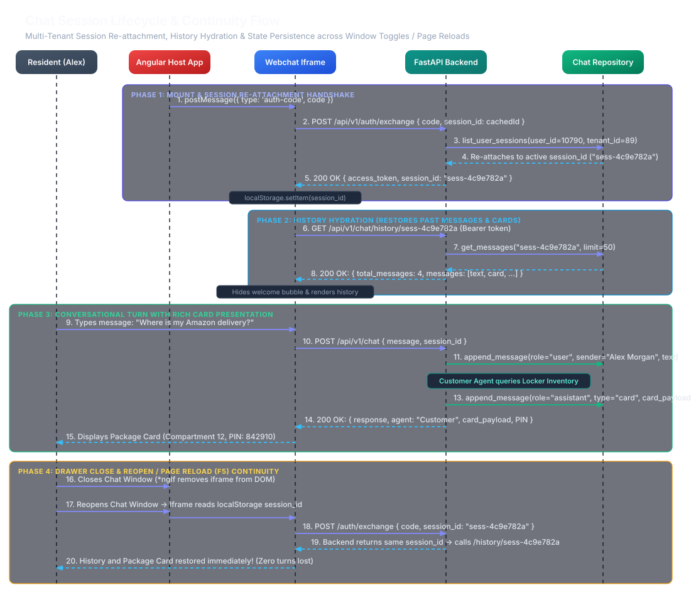
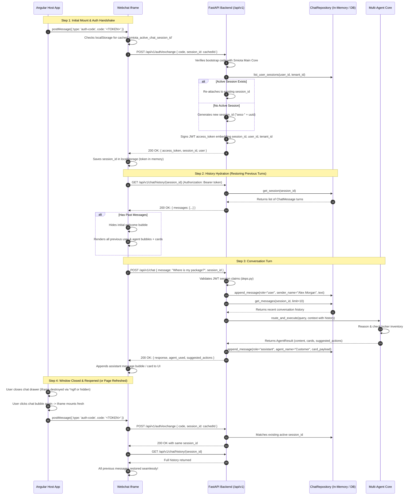
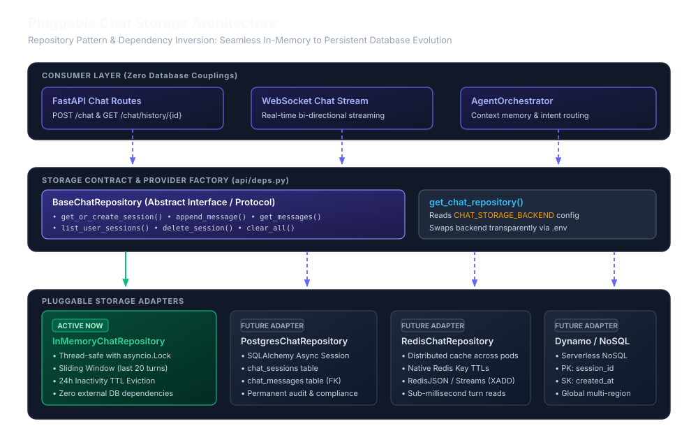

# Smiota Chat Session Management & Continuity Architecture

This document provides a comprehensive technical specification of how conversation sessions, message history, user attribution, and continuity are managed across the **Mailroom Web Application (Angular Host)**, the **Embedded Webchat Iframe**, and the **Smiota AI Backend (FastAPI)**.

---

## 1. Architectural Goals & Problem Statement

### 1.1 Goals
1. **Frictionless Continuity**: The user must never lose their conversation history if they close/reopen the chat drawer, navigate away, or reload the page (F5).
2. **Strict Multi-Tenant Security**: Every chat session is cryptographically bound to a verified `user_id` and `tenant_id`. Resident A can never access or inspect Resident B's conversation history.
3. **Actor & Presentation Attribution**: Messages explicitly distinguish between human residents (`role="user"`) and specialized agents (`role="assistant"` with `agent_name="Customer"`, `"Security"`, etc.), while supporting both plain text and rich visual cards (e.g. package tracking, locker door unlock confirmation).
4. **Pluggable Storage Abstraction**: The storage implementation operates in-memory today with automatic TTL eviction and sliding window protection, but is decoupled behind an abstract repository pattern so it can be swapped for **PostgreSQL** or **Redis** with **zero code changes** to endpoints or agents.

---

## 2. End-to-End Lifecycle & Sequence Flow



<details open>
<summary><b>Mermaid Diagram Source</b></summary>



</details>

---

## 3. Data Models & Contracts

### 3.1 `ChatMessage` (Individual Message Turn)
Defined in [`src/smiota/schemas/chat_session.py`](file:///d:/repos/smiota-ai/src/smiota/schemas/chat_session.py):

| Field | Type | Description |
| :--- | :--- | :--- |
| `id` | `str` | Unique message identifier (e.g. `msg-84f92a1012`) |
| `session_id` | `str` | Foreign key linking to parent `ChatSession` |
| `role` | `"user" \| "assistant" \| "system"` | Standard actor classification |
| `sender_name` | `str \| None` | Display name (e.g., `"Alex Morgan"` or `"Customer Assistant"`) |
| `agent_name` | `str \| None` | AI Agent identifier (`"Customer"`, `"Security"`, `"AIOps"`) |
| `message_type` | `MessageType` | Visual render type: `"text"`, `"card"`, `"approval_gate"`, `"quick_replies"` |
| `content` | `str` | Clean markdown text representation (consumed by LLM memory & screen readers) |
| `card_payload` | `dict \| None` | Structured JSON data for interactive cards (tracking, PINs, locker compartments) |
| `suggested_actions` | `list[str]` | Action pill buttons (e.g. `["Track package", "Resend PIN"]`) |
| `created_at` | `datetime` | UTC timestamp of message creation |
| `metadata` | `dict` | Custom turn attributes |

#### Example: User Message Turn
```json
{
  "id": "msg-a1b2c3d4",
  "session_id": "sess-4c9e782a94ef",
  "role": "user",
  "sender_name": "Alex Morgan",
  "agent_name": null,
  "message_type": "text",
  "content": "Where is my package?",
  "card_payload": null,
  "suggested_actions": [],
  "created_at": "2026-10-21T13:30:00Z"
}
```

#### Example: Agent Rich Card Turn
```json
{
  "id": "msg-e5f6g7h8",
  "session_id": "sess-4c9e782a94ef",
  "role": "assistant",
  "sender_name": "Customer Assistant",
  "agent_name": "Customer",
  "message_type": "card",
  "content": "Your package is ready in Locker Compartment 12. Pickup PIN: 842910.",
  "card_payload": {
    "card_type": "package_pickup",
    "tracking_number": "SM-9941",
    "carrier": "Amazon Logistics",
    "building": "North Tower",
    "compartment": "12",
    "pickup_pin": "842910",
    "status": "Ready for Pickup"
  },
  "suggested_actions": ["Resend pickup PIN", "Locker hours"],
  "created_at": "2026-10-21T13:30:02Z"
}
```

---

### 3.2 `ChatSession` (Session Envelope)

| Field | Type | Description |
| :--- | :--- | :--- |
| `session_id` | `str` | Primary key identifier (e.g. `sess-4c9e782a94ef`) |
| `user_id` | `str` | Verified user identity (e.g. `"10790"`) |
| `tenant_id` | `str` | Verified tenant identifier (e.g. `"89"`) |
| `channel` | `str` | Origin channel (`"webchat"`, `"teams"`, `"slack"`) |
| `created_at` | `datetime` | UTC timestamp when session was initialized |
| `updated_at` | `datetime` | UTC timestamp of last activity (used for TTL evaluation) |
| `metadata` | `dict` | Session-level facts (e.g. `{"building": "North Tower", "unit": "Suite 400"}`) |
| `messages` | `list[ChatMessage]` | Ordered history turns |

---

## 4. The 4 Continuity Scenarios & How They Are Handled

### Scenario 1: User Sends Messages in an Open Window
* Each turn appends to the active `session_id` in `InMemoryChatRepository`.
* Recent turns are passed to `context.conversation_history` so Gemini / specialized agents maintain multi-turn context (e.g. pronoun resolution: *"Is it still there?"* refers to the package from the previous turn).

### Scenario 2: User Closes and Reopens the Chat Drawer
* In Angular, closing the drawer removes the iframe from DOM (`*ngIf="isChatOpen"`) or hides it.
* When reopened:
  1. Angular sends `auth-code`.
  2. The iframe checks `localStorage` and includes `{ code, session_id: cachedId }`.
  3. `POST /api/v1/auth/exchange` recognizes the active session for `user_id: 10790` and returns the **same `session_id`**.
  4. The iframe calls `GET /api/v1/chat/history/{session_id}`.
  5. The previous conversation is instantly re-rendered.

### Scenario 3: User Refreshes the Browser (F5) or Opens a New Tab
* The browser reloads the entire page.
* The iframe loads `smiota_active_chat_session_id` from `localStorage`.
* It re-authenticates and restores the history. The user continues seamlessly.

### Scenario 4: User Is Inactive for Over 24 Hours (TTL Expiration)
* The repository's automatic eviction policy checks `now - session.updated_at > ttl (24 hours)`.
* The expired session is dropped to prevent memory leaks.
* The next exchange cleanly starts a new session with the welcome prompt.

---

## 5. Browser Storage Strategy & Multi-Tier Expiration Model

### 5.1 Are We Storing the Session into `localStorage`?
**Yes, but strictly as an opaque reference pointer.**

| Item | Stored in `localStorage`? | Where It Actually Lives | Security & Privacy Rationale |
| :--- | :---: | :--- | :--- |
| **Session ID Pointer** (`smiota_active_chat_session_id`) | **YES** | Browser `localStorage` | Contains only an opaque string (e.g. `"sess-4c9e782a94ef"`). Retains continuity across drawer close (`*ngIf`) and page refresh (F5). |
| **Conversation Messages** (Text, Package PINs, Locker Compartments) | **NO** | Backend [`InMemoryChatRepository`](file:///d:/repos/smiota-ai/src/smiota/repositories/chat_repository.py) | **Zero sensitive resident data or locker PINs** stored in the browser. Immune to browser storage inspection and XSS theft. |
| **JWT Access Token** | **NO** | Iframe JavaScript Closure Variable | Never written to disk; securely discarded when the iframe is destroyed. |
| **Resident Profile** | **NO** | Backend Spring Boot & Session Tokens | Resident details (Alex Morgan, Unit 400) reside only in verified server memory. |

#### Why `localStorage` instead of `sessionStorage`?
In Angular host applications, closing the chat drawer unmounts the `<iframe>` DOM element via `*ngIf="isChatOpen"`. When the resident clicks the chat bubble again, a brand new `<iframe>` document context is created. In many browsers, `sessionStorage` is scoped to the document context and can be cleared or isolated when an iframe is recreated. `localStorage` guarantees that the resident's session reference survives drawer toggle and full page reloads.

---

### 5.2 How Does the Session Expire? (The 5-Tier Expiration Lifecycle)

Session expiration is enforced across 5 layers:

```
+-------------------------------------------------------------------------------------------------+
|                                 5-TIER SESSION EXPIRATION MODEL                                 |
+-------------------------------------------------------------------------------------------------+
|                                                                                                 |
|  [Tier 1: Server TTL]        [Tier 2: Stale Detection]        [Tier 3: JWT Token Expiry]        |
|  24-Hour Sliding Window      Server checks if ID is alive     Auth token expires in 60 min      |
|  _evict_expired() drops      If expired, discards dead ID     Requires fresh exchange code      |
|  inactive sessions from RAM  and issues brand new session     from Angular host                 |
|                                                                                                 |
|  [Tier 4: User Switch Guard] [Tier 5: Manual Reset Button]                                      |
|  Alex logs out, John logs in "New Chat" button in header                                        |
|  Server verifies user_id     clears localStorage immediately                                    |
|  Rejects cross-user session  and starts fresh conversation                                      |
+-------------------------------------------------------------------------------------------------+
```

#### Tier 1: Server-Side Inactivity Sliding Window (TTL)
* **Configuration**: `CHAT_SESSION_TTL_HOURS = 24` (in `.env`).
* **Mechanism**: Every session maintains `created_at` and `updated_at`. When a resident sends a message, `updated_at` refreshes.
* **Eviction**: Before every operation, [`_evict_expired()`](file:///d:/repos/smiota-ai/src/smiota/repositories/chat_repository.py#L206) purges all sessions where `datetime.now(UTC) - session.updated_at > ttl`. All stored turns and card payloads are freed from RAM.

#### Tier 2: Stale Session Detection on Re-Exchange
* If a resident returns after 3 days, their browser sends the stale `cachedSid` (`sess-old`) in [`POST /api/v1/auth/exchange`](file:///d:/repos/smiota-ai/src/smiota/api/v1/auth.py#L38).
* The server calls `chat_repo.get_session(cachedSid)`.
* Because 3 days > 24 hours, `_evict_expired()` already deleted it, returning `None`.
* The server **discards the dead ID**, creates a **brand new `session_id`** (`sess-new-uuid`), and returns it.
* The client overwrites `localStorage.setItem('smiota_active_chat_session_id', 'sess-new-uuid')` and renders a clean welcome screen.

#### Tier 3: JWT Authentication Token Expiration
* The chat JWT token has a lifetime of 60 minutes (`SESSION_TOKEN_EXPIRE_MINUTES`).
* If a session stays idle in an open tab past token expiry, API calls return `401 Unauthorized`.
* The widget re-initiates the `postMessage('auth-code')` handshake to get a fresh token.

#### Tier 4: Cross-User Account Switch Protection
* If Resident A logs out and Resident B logs into the Mailroom portal on the same shared computer:
* Resident B's auth exchange passes Resident A's cached `session_id`.
* The server checks: `if existing.user_id == identity.user_id and existing.tenant_id == identity.tenant_id:`
* Since `user_id` does not match, the server **rejects the old session**, issues a new isolated session for Resident B, and overwrites `localStorage`. Resident B can never see Resident A's conversation.

#### Tier 5: Explicit Resident Reset ("New Chat" Button)
* A **"New Chat"** button is built into the header of [`webchat.py`](file:///d:/repos/smiota-ai/src/smiota/api/v1/channels/webchat.py#L240).
* Clicking it executes `localStorage.removeItem('smiota_active_chat_session_id')` and refreshes the canvas, allowing residents or QA testers to clear their chat history on demand.

---

### 5.3 Codebase Implementation Map

| Purpose | File & Location |
| :--- | :--- |
| **Cache Session ID in `localStorage`** | [`src/smiota/api/v1/channels/webchat.py:L327`](file:///d:/repos/smiota-ai/src/smiota/api/v1/channels/webchat.py#L327) & [`L390`](file:///d:/repos/smiota-ai/src/smiota/api/v1/channels/webchat.py#L390) |
| **Re-attach & Validate Alive Session** | [`src/smiota/api/v1/auth.py:L38-L47`](file:///d:/repos/smiota-ai/src/smiota/api/v1/auth.py#L38-L47) |
| **TTL Expiration & Memory Eviction** | [`src/smiota/repositories/chat_repository.py:L206-L215`](file:///d:/repos/smiota-ai/src/smiota/repositories/chat_repository.py#L206-L215) |
| **Multi-Tenant History Hydration** | [`src/smiota/api/v1/chat.py:L82-L106`](file:///d:/repos/smiota-ai/src/smiota/api/v1/chat.py#L82-L106) |
| **"New Chat" Reset Button & Handler** | [`src/smiota/api/v1/channels/webchat.py:L240`](file:///d:/repos/smiota-ai/src/smiota/api/v1/channels/webchat.py#L240) & [`L720`](file:///d:/repos/smiota-ai/src/smiota/api/v1/channels/webchat.py#L720) |

---

## 6. Storage Provider Abstraction (Future-Proofing)



All session operations go through the abstract interface [`BaseChatRepository`](file:///d:/repos/smiota-ai/src/smiota/repositories/chat_repository.py):

```python
class BaseChatRepository(ABC):
    @abstractmethod
    async def get_or_create_session(...) -> ChatSession: ...
    @abstractmethod
    async def append_message(...) -> ChatMessage: ...
    @abstractmethod
    async def get_messages(...) -> list[ChatMessage]: ...
    @abstractmethod
    async def list_user_sessions(...) -> list[ChatSession]: ...
    @abstractmethod
    async def delete_session(...) -> bool: ...
```

### How to Switch from In-Memory to PostgreSQL or Redis Later
When you are ready to migrate to a permanent database, **zero changes** are required in your API endpoints, webchat iframe, or agent orchestrator:

1. Create `PostgresChatRepository(BaseChatRepository)` using SQLAlchemy or `RedisChatRepository(BaseChatRepository)`.
2. Update the factory function in [`src/smiota/repositories/chat_repository.py`](file:///d:/repos/smiota-ai/src/smiota/repositories/chat_repository.py#L210):
   ```python
   def get_chat_repository() -> BaseChatRepository:
       backend = get_settings().CHAT_STORAGE_BACKEND.lower()
       if backend == "postgres":
           return PostgresChatRepository()
       elif backend == "redis":
           return RedisChatRepository()
       return _in_memory_instance
   ```
3. Update `.env`:
   ```bash
   CHAT_STORAGE_BACKEND=postgres
   ```

---

## 7. API Reference

### 7.1 `POST /api/v1/auth/exchange`
Exchanges a single-use token or re-attaches to an active session.

**Request Body:**
```json
{
  "code": "smiota-auth-code-123",
  "session_id": "sess-4c9e782a94ef" // Optional: cached active session
}
```

**Response (200 OK):**
```json
{
  "token_type": "Bearer",
  "access_token": "eyJhbGciOiJIUzI1NiIsIn...",
  "expires_in": 3600,
  "session_id": "sess-4c9e782a94ef",
  "user": {
    "user_id": "10790",
    "tenant_id": "89",
    "name": "Alex Morgan",
    "building_name": "North Tower",
    "unit_no": "Suite 400"
  }
}
```

---

### 7.2 `GET /api/v1/chat/history/{session_id}`
Retrieves all historical message turns and cards for the active session.

**Headers:**
```http
Authorization: Bearer <access_token>
```

**Response (200 OK):**
```json
{
  "session_id": "sess-4c9e782a94ef",
  "user_id": "10790",
  "tenant_id": "89",
  "channel": "webchat",
  "total_messages": 4,
  "messages": [
    {
      "id": "msg-001",
      "session_id": "sess-4c9e782a94ef",
      "role": "user",
      "sender_name": "Alex Morgan",
      "message_type": "text",
      "content": "Where is my package?",
      "card_payload": null,
      "suggested_actions": [],
      "created_at": "2026-10-21T13:30:00Z"
    },
    {
      "id": "msg-002",
      "session_id": "sess-4c9e782a94ef",
      "role": "assistant",
      "sender_name": "Customer Assistant",
      "agent_name": "Customer",
      "message_type": "card",
      "content": "Your package is in Locker Compartment 12.",
      "card_payload": {
        "card_type": "package_pickup",
        "tracking_number": "SM-9941",
        "compartment": "12",
        "pickup_pin": "842910"
      },
      "suggested_actions": ["Resend pickup PIN"],
      "created_at": "2026-10-21T13:30:02Z"
    }
  ]
}
```

---

### 7.3 Security Enforcement
* Calling `GET /api/v1/chat/history/{session_id}` without a valid Bearer token returns **`401 Unauthorized`**.
* Attempting to query another user's `session_id` across tenants returns **`403 Forbidden` (`error_code: "FORBIDDEN"`)**.
