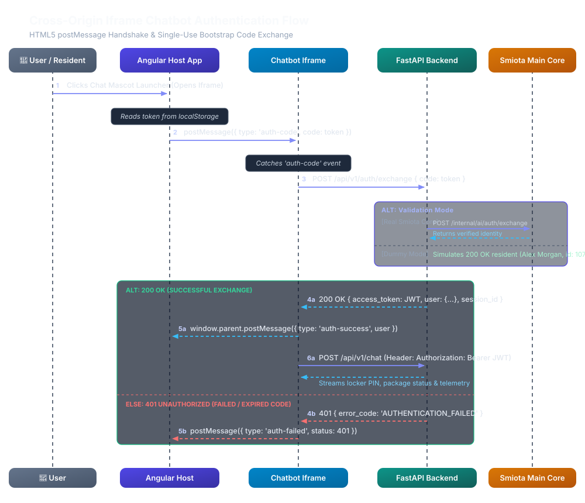
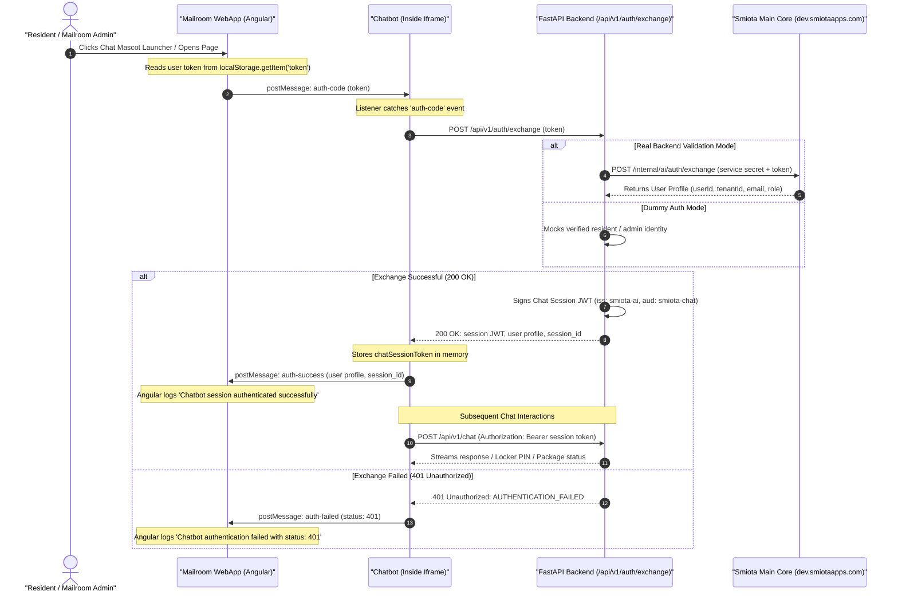

# Cross-Origin Iframe Chatbot Authentication Architecture

This document provides a comprehensive technical specification of the cross-origin communication and authentication handshake between the **Mailroom Web Application (Angular Host)** and the **Smiota AI Chatbot (Embedded Iframe)**.

---

## 1. Architecture Overview & Problem Statement

### 1.1 Context
* **Host Application**: Mailroom WebApp (`mailroom-webapp`, Angular) running on `http://localhost:4200` or `https://dev.smiotaapps.com`.
* **Chatbot Widget**: Smiota AI Webchat (`smiota-ai`, FastAPI) served inside an `<iframe>` hosted on `https://ai-automation-production-ef2d.up.railway.app`.

### 1.2 The Security Boundary (Same-Origin Policy)
Under standard web security rules (Same-Origin Policy), the host page and the embedded iframe cannot directly access each other’s DOM, memory, cookies, or `localStorage`. 

To establish an authenticated session for the current logged-in user:
1. Tokens must **not** be passed via query parameters in URLs (to prevent leakage in server access logs, browser history, and `Referer` headers).
2. The browser's native **HTML5 `window.postMessage()`** API is used to create a bidirectional, asynchronous messaging bridge between the two independent window contexts.

---

## 2. End-to-End Sequence Diagram



<details open>
<summary><b>Mermaid Diagram Source</b></summary>



</details>

---

## 3. Communication Contracts & Message Schemas

### 3.1 Host $\rightarrow$ Iframe (Initiate Authentication)
Sent by Angular when the iframe loads or when the user toggles the chat open:
```json
{
  "type": "auth-code",
  "code": "<SMIOTA_SESSION_OR_BOOTSTRAP_TOKEN>"
}
```

### 3.2 Iframe $\rightarrow$ Backend (Token Exchange)
`POST /api/v1/auth/exchange`
```json
// Request Body
{
  "code": "<SMIOTA_SESSION_OR_BOOTSTRAP_TOKEN>"
}

// Successful Response (200 OK)
{
  "access_token": "eyJhbGciOiJIUzI1NiIsInR5cCI6IkpXVCJ9...",
  "token_type": "bearer",
  "session_id": "sess-a1b2c3d4",
  "user": {
    "user_id": "1054",
    "email": "user@example.com",
    "tenant_id": "tenant-001",
    "location_id": "1",
    "role": "tenant"
  }
}

// Error Response (401 Unauthorized)
{
  "success": false,
  "error_code": "AUTHENTICATION_FAILED",
  "message": "Bootstrap code is invalid, expired, or was already consumed.",
  "details": {}
}
```

### 3.3 Iframe $\rightarrow$ Host (Handshake Status)
Sent back to the parent window upon exchange resolution:

* **Success Notification**:
  ```json
  {
    "type": "auth-success",
    "user": {
      "user_id": "1054",
      "email": "user@example.com",
      "tenant_id": "tenant-001",
      "location_id": "1",
      "role": "tenant"
    },
    "session_id": "sess-a1b2c3d4"
  }
  ```

* **Failure Notification**:
  ```json
  {
    "type": "auth-failed",
    "status": 401
  }
  ```

---

## 4. Source Code Implementations

### 4.1 Mailroom WebApp (Angular)

#### `src/app/layout/layout.component.html`
```html
<div class="chat-iframe-wrapper" [style.display]="isChatOpen ? 'flex' : 'none'">
    <iframe
        #chatIframe
        src="https://ai-automation-production-ef2d.up.railway.app/api/v1/channels/webchat/embed"
        class="chat-iframe"
        title="AI Assistant Chat"
        allow="microphone; camera"
        (load)="onChatIframeLoaded()">
    </iframe>
</div>
```

#### `src/app/layout/layout.component.ts`
```typescript
import { Component, OnInit, ViewChild, ElementRef, HostListener } from '@angular/core';

export class LayoutComponent implements OnInit {
    @ViewChild('chatIframe') chatIframe: ElementRef;
    isChatOpen = false;

    toggleChat(): void {
        this.isChatOpen = !this.isChatOpen;
        if (this.isChatOpen) {
            this.sendAuthToChat();
        }
    }

    onChatIframeLoaded(): void {
        this.sendAuthToChat();
    }

    private sendAuthToChat(): void {
        const token = localStorage.getItem('token');
        if (!token) return;

        const iframeWindow = (this.chatIframe && this.chatIframe.nativeElement)
            ? this.chatIframe.nativeElement.contentWindow
            : null;

        if (iframeWindow) {
            iframeWindow.postMessage({
                type: 'auth-code',
                code: token
            }, '*'); // In production, specify Railway target origin
        }
    }

    @HostListener('window:message', ['$event'])
    onChatMessageReceived(event: MessageEvent): void {
        if (!event.data) return;

        if (event.data.type === 'auth-success') {
            console.log('Chatbot session authenticated successfully for user:', event.data.user);
        } else if (event.data.type === 'auth-failed') {
            console.warn('Chatbot authentication failed with status:', event.data.status);
        }
    }
}
```

---

### 4.2 Smiota AI Webchat (Embedded Script)

#### `src/smiota/api/v1/channels/webchat.py`
```javascript
let chatSessionToken = null;
let authenticatedUser = null;

async function exchangeBootstrapCode(bootstrapCode) {
    if (!bootstrapCode) return;
    try {
        console.log("Exchanging bootstrap code for chatbot session...");
        const res = await fetch('/api/v1/auth/exchange', {
            method: 'POST',
            headers: { 'Content-Type': 'application/json' },
            body: JSON.stringify({ code: bootstrapCode })
        });
        
        if (res.ok) {
            const data = await res.json();
            chatSessionToken = data.access_token;
            authenticatedUser = data.user;
            console.log("Chatbot session established for user:", data.user?.user_id);
            window.parent.postMessage({ 
                type: 'auth-success', 
                user: data.user, 
                session_id: data.session_id 
            }, '*');
        } else {
            console.warn("Bootstrap code exchange rejected with status:", res.status);
            window.parent.postMessage({ 
                type: 'auth-failed', 
                status: res.status 
            }, '*');
        }
    } catch (err) {
        console.error("Error exchanging bootstrap code:", err);
    }
}

// 1. Listen for postMessage from parent host application
window.addEventListener('message', (event) => {
    if (!event.data) return;
    if (event.data.type === 'auth-code' && event.data.code) {
        exchangeBootstrapCode(event.data.code);
    }
});

// 2. Fallback query parameter (?code=...)
const initialCode = urlParams.get('code');
if (initialCode) {
    exchangeBootstrapCode(initialCode);
}
```

---

## 5. Security & Production Checklist

| Category | Recommendation | Status |
| :--- | :--- | :--- |
| **Origin Verification** | Replace target `'*'` with the explicit target domain (e.g. `event.origin === 'https://dev.smiotaapps.com'`) in message listeners. | Recommended for Prod |
| **URL Parameter Safety** | Keep `postMessage` as the primary transport; avoid putting long-lived JWTs in `?code=` query parameters. | Implemented |
| **Identity Protection** | Backend sanitizes all client metadata so users cannot spoof `tenant_id` or `user_id`. | Implemented in `chat.py` |
| **Dummy Auth Mode** | Ensure `SMIOTA_AUTH_DUMMY_MODE=False` in production deployment environments. | Configurable via `.env` |
| **Session Lifetime** | Tokens expire after `ACCESS_TOKEN_EXPIRE_MINUTES` (default 60 mins). | Configured |
