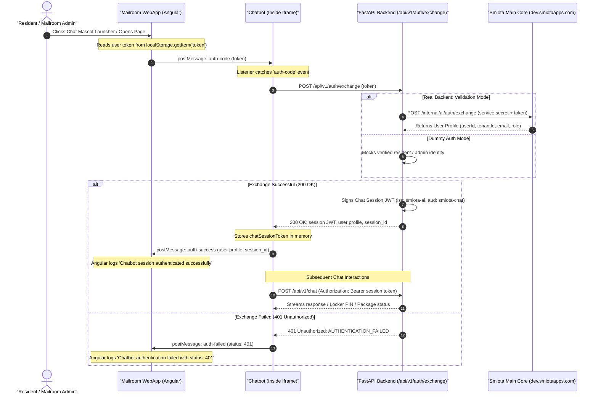
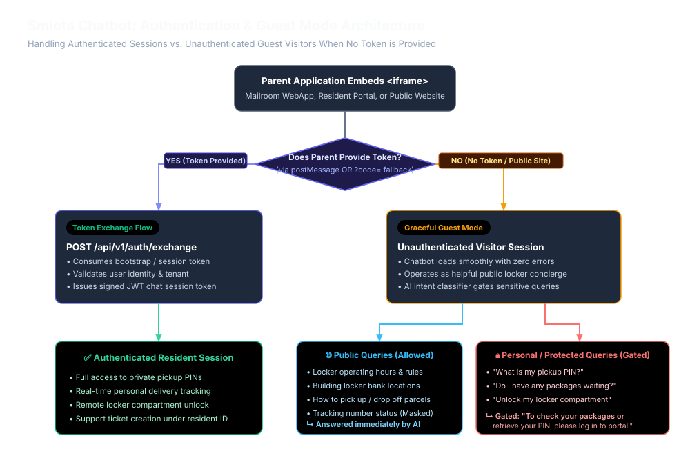
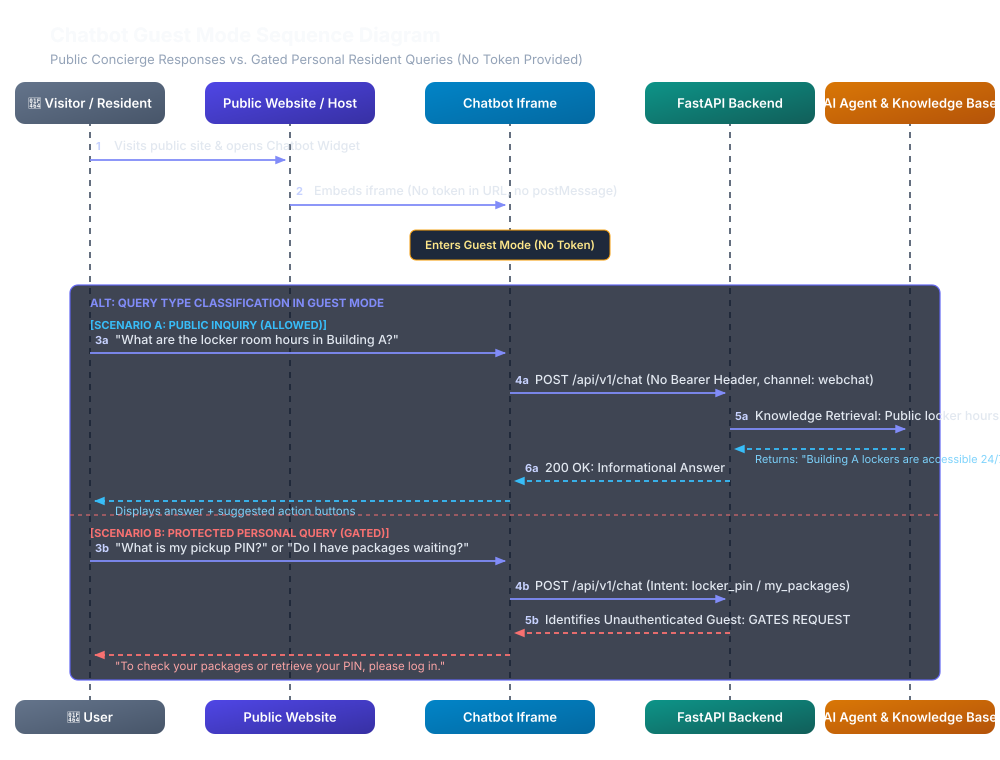
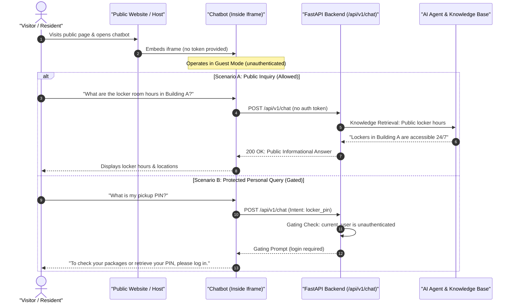

# Cross-Origin Iframe Chatbot Authentication Architecture

This document provides a comprehensive technical specification of the cross-origin communication and authentication handshake between the **Mailroom Web Application (Angular Host)** and the **Smiota AI Chatbot (Embedded Iframe)**.

---

## 1. Architecture Overview & Problem Statement

### 1.1 Context
* **Host Application**: Mailroom WebApp (`mailroom-webapp`, Angular) running on `http://localhost:4200` or `https://dev.smiotaapps.com`.
* **Chatbot Widget**: Smiota AI Webchat (`smiota-ai`, FastAPI) served inside an `<iframe>` hosted on `https://ai-automation-production-ef2d.up.railway.app`.

### 1.2 The Security Boundary (Same-Origin Policy)
Under standard web security rules (Same-Origin Policy), the host page and the embedded iframe cannot directly access each other’s DOM, memory, cookies, or `localStorage`. 

To establish an authenticated session for the current logged-in user:
1. Tokens must **not** be passed via query parameters in URLs (to prevent leakage in server access logs, browser history, and `Referer` headers).
2. The browser's native **HTML5 `window.postMessage()`** API is used to create a bidirectional, asynchronous messaging bridge between the two independent window contexts.

---

## 2. End-to-End Sequence Diagram


<details open>
<summary><b>Mermaid Diagram Source</b></summary>



</details>

---

## 3. Communication Contracts & Message Schemas

### 3.1 Host $\rightarrow$ Iframe (Initiate Authentication)
Sent by Angular when the iframe loads or when the user toggles the chat open:
```json
{
  "type": "auth-code",
  "code": "<SMIOTA_SESSION_OR_BOOTSTRAP_TOKEN>"
}
```

### 3.2 Internal Smiota Main App $\rightarrow$ FastAPI Backend Payload
`POST /internal/ai/auth/exchange` (or returned during code validation):
```json
{
  "id": 10790,
  "uuid": "4c9e782a-94ef-4b21-8854-bc712f5b66d1",
  "firstName": "Alex",
  "lastName": "Morgan",
  "recipientName": "Alex Morgan",
  "email": "alex.morgan@acme.com",
  "phone": "+14155551234",
  "voiceCallPhone": "+14155551234",
  "photo": null,
  "badgeId": "BADGE-9941",
  "authId": "auth0|64f1a23e9821a",
  "externalId": "EMP-88214",
  "login": "amorgan",

  "customerId": 42,
  "locationId": 108,
  "locationName": "Pleasanton HQ",
  "buildingId": 15,
  "buildingName": "North Tower",
  "tenantId": 89,
  "tenantName": "Acme Technologies Inc.",
  "unitNo": "Suite 400",
  "recipientId": 10790,

  "isInActive": false,
  "inactive": false,
  "authorizedForTenant": true,
  "wheelChairAccess": false,
  "hasSpecialStatus": false,
  "optOut": false,
  "emailUnsubscribe": false,
  "phoneUnsubscribe": false,
  "registrationStatus": 1,
  "keepLocalChanges": false,

  "addressLine1": "100 Innovation Way",
  "addressLine2": null,
  "city": "Pleasanton",
  "state": "CA",
  "zipCode": "94588",

  "passcode": "842910",
  "lastPasscodeCreatedTime": "2026-10-15T08:30:00Z",
  "passcodeGenerationRequired": false,
  "doNotAssociateToAPackage": false,
  "delegatesNotificationsToUserId": 0,
  "delegatesNotificationsToUserNamed": null,

  "roles": [
    "recipient"
  ],
  "roleObjects": [
    {
      "roleId": 10,
      "role": "recipient",
      "scope": 108,
      "scopeId": "108",
      "userId": 10790
    }
  ]
}
```

### 3.3 Iframe $\rightarrow$ FastAPI Backend (Token Exchange)
`POST /api/v1/auth/exchange`
```json
// Request Body
{
  "code": "<SMIOTA_SESSION_OR_BOOTSTRAP_TOKEN>"
}

// Successful Response (200 OK)
{
  "token_type": "Bearer",
  "access_token": "eyJhbGciOiJIUzI1NiIsInR5cCI6IkpXVCJ9...",
  "expires_in": 3600,
  "session_id": "sess-a1b2c3d4",
  "user": {
    "user_id": "10790",
    "tenant_id": "89",
    "roles": ["recipient"],
    "email": "alex.morgan@acme.com",
    "name": "Alex Morgan",
    "first_name": "Alex",
    "last_name": "Morgan",
    "phone": "+14155551234",
    "location_id": "108",
    "location_name": "Pleasanton HQ",
    "building_id": "15",
    "building_name": "North Tower",
    "tenant_name": "Acme Technologies Inc.",
    "unit_no": "Suite 400",
    "passcode": "842910",
    "raw_profile": { ... }
  }
}

// Error Response (401 Unauthorized)
{
  "success": false,
  "error_code": "AUTHENTICATION_FAILED",
  "message": "Bootstrap code is invalid, expired, or was already consumed.",
  "details": {}
}
```

### 3.4 Iframe $\rightarrow$ Host (Handshake Status)
Sent back to the parent window upon exchange resolution:

* **Success Notification**:
  ```json
  {
    "type": "auth-success",
    "user": {
      "user_id": "10790",
      "tenant_id": "89",
      "roles": ["recipient"],
      "email": "alex.morgan@acme.com",
      "name": "Alex Morgan",
      "location_id": "108",
      "building_name": "North Tower",
      "unit_no": "Suite 400"
    },
    "session_id": "sess-a1b2c3d4"
  }
  ```

* **Failure Notification**:
  ```json
  {
    "type": "auth-failed",
    "status": 401
  }
  ```

---

## 4. Source Code Implementations

### 4.1 Mailroom WebApp (Angular)

#### `src/app/layout/layout.component.html`
```html
<div class="chat-iframe-wrapper" [style.display]="isChatOpen ? 'flex' : 'none'">
    <iframe
        #chatIframe
        src="https://ai-automation-production-ef2d.up.railway.app/api/v1/channels/webchat/embed"
        class="chat-iframe"
        title="AI Assistant Chat"
        allow="microphone; camera"
        (load)="onChatIframeLoaded()">
    </iframe>
</div>
```

#### `src/app/layout/layout.component.ts`
```typescript
import { Component, OnInit, ViewChild, ElementRef, HostListener } from '@angular/core';

export class LayoutComponent implements OnInit {
    @ViewChild('chatIframe') chatIframe: ElementRef;
    isChatOpen = false;

    toggleChat(): void {
        this.isChatOpen = !this.isChatOpen;
        if (this.isChatOpen) {
            this.sendAuthToChat();
        }
    }

    onChatIframeLoaded(): void {
        this.sendAuthToChat();
    }

    private sendAuthToChat(): void {
        const token = localStorage.getItem('token');
        if (!token) return;

        const iframeWindow = (this.chatIframe && this.chatIframe.nativeElement)
            ? this.chatIframe.nativeElement.contentWindow
            : null;

        if (iframeWindow) {
            iframeWindow.postMessage({
                type: 'auth-code',
                code: token
            }, '*'); // In production, specify Railway target origin
        }
    }

    @HostListener('window:message', ['$event'])
    onChatMessageReceived(event: MessageEvent): void {
        if (!event.data) return;

        if (event.data.type === 'auth-success') {
            console.log('Chatbot session authenticated successfully for user:', event.data.user);
        } else if (event.data.type === 'auth-failed') {
            console.warn('Chatbot authentication failed with status:', event.data.status);
        }
    }
}
```

---

### 4.2 Smiota AI Webchat (Embedded Script)

#### `src/smiota/api/v1/channels/webchat.py`
```javascript
let chatSessionToken = null;
let authenticatedUser = null;

async function exchangeBootstrapCode(bootstrapCode) {
    if (!bootstrapCode) return;
    try {
        console.log("Exchanging bootstrap code for chatbot session...");
        const res = await fetch('/api/v1/auth/exchange', {
            method: 'POST',
            headers: { 'Content-Type': 'application/json' },
            body: JSON.stringify({ code: bootstrapCode })
        });
        
        if (res.ok) {
            const data = await res.json();
            chatSessionToken = data.access_token;
            authenticatedUser = data.user;
            console.log("Chatbot session established for user:", data.user?.user_id);
            window.parent.postMessage({ 
                type: 'auth-success', 
                user: data.user, 
                session_id: data.session_id 
            }, '*');
        } else {
            console.warn("Bootstrap code exchange rejected with status:", res.status);
            window.parent.postMessage({ 
                type: 'auth-failed', 
                status: res.status 
            }, '*');
        }
    } catch (err) {
        console.error("Error exchanging bootstrap code:", err);
    }
}

// 1. Listen for postMessage from parent host application
window.addEventListener('message', (event) => {
    if (!event.data) return;
    if (event.data.type === 'auth-code' && event.data.code) {
        exchangeBootstrapCode(event.data.code);
    }
});

// 2. Fallback query parameter (?code=...)
const initialCode = urlParams.get('code');
if (initialCode) {
    exchangeBootstrapCode(initialCode);
}
```

---

## 5. Fallback & Guest Mode Strategies (Non-postMessage Hosts)

If a parent application embeds the chatbot `<iframe>` but does **not** implement `window.postMessage`, the architecture provides two resilient operating strategies:



### 5.1 Strategy A: The URL Parameter Fallback (Built into `webchat.py`)

The embedded widget script automatically checks for a `?code=` query parameter on initialization:

```javascript
// Auto-exchange if code query parameter is provided in iframe URL (?code=...)
const initialCode = urlParams.get('code');
if (initialCode) {
    exchangeBootstrapCode(initialCode);
}
```

#### How it works for the parent:
The parent application does not need to write any JavaScript or `postMessage` listeners. It only needs to render the iframe HTML with the bootstrap token appended:

```html
<iframe src="https://ai-automation-production-ef2d.up.railway.app/api/v1/channels/webchat/embed?code=USER_TOKEN"></iframe>
```

The iframe automatically reads `?code=USER_TOKEN` and runs the exact same `/api/v1/auth/exchange` handshake without needing postMessage.

---

### 5.2 Strategy B: Graceful "Guest Mode" (Public vs. Private Queries)

If the parent application provides **no token at all** (e.g. on a public marketing site or unauthenticated portal):

#### 1. Public Queries (Allowed)
The chatbot answers general questions and informational queries from the public knowledge base:
* *"What are the locker room hours?"*
* *"How do I pick up a package using Smiota?"*
* *"Where are the lockers located in Building B?"*

#### 2. Personal / Protected Queries (Gated)
When the user asks for personal, resident-specific data:
* *"What is my locker PIN?"*
* *"Do I have any packages waiting?"*
* *"Unlock my compartment door"*

The AI detects that `current_user` is an unauthenticated guest and politely responds:
> *"To check your packages or retrieve your pickup PIN, please log in to your resident portal."*

#### 3. Guest Mode End-to-End Sequence Diagram



<details open>
<summary><b>Mermaid Diagram Source (Guest Mode)</b></summary>



</details>

---

## 6. Security & Production Checklist

| Category | Recommendation | Status |
| :--- | :--- | :--- |
| **Origin Verification** | Replace target `'*'` with the explicit target domain (e.g. `event.origin === 'https://dev.smiotaapps.com'`) in message listeners. | Recommended for Prod |
| **URL Parameter Safety** | Keep `postMessage` as the primary transport; avoid putting long-lived JWTs in `?code=` query parameters. | Implemented |
| **Identity Protection** | Backend sanitizes all client metadata so users cannot spoof `tenant_id` or `user_id`. | Implemented in `chat.py` |
| **Dummy Auth Mode** | Ensure `SMIOTA_AUTH_DUMMY_MODE=False` in production deployment environments. | Configurable via `.env` |
| **Session Lifetime** | Tokens expire after `ACCESS_TOKEN_EXPIRE_MINUTES` (default 60 mins). | Configured |
