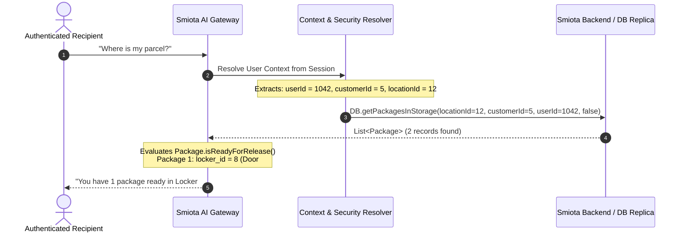
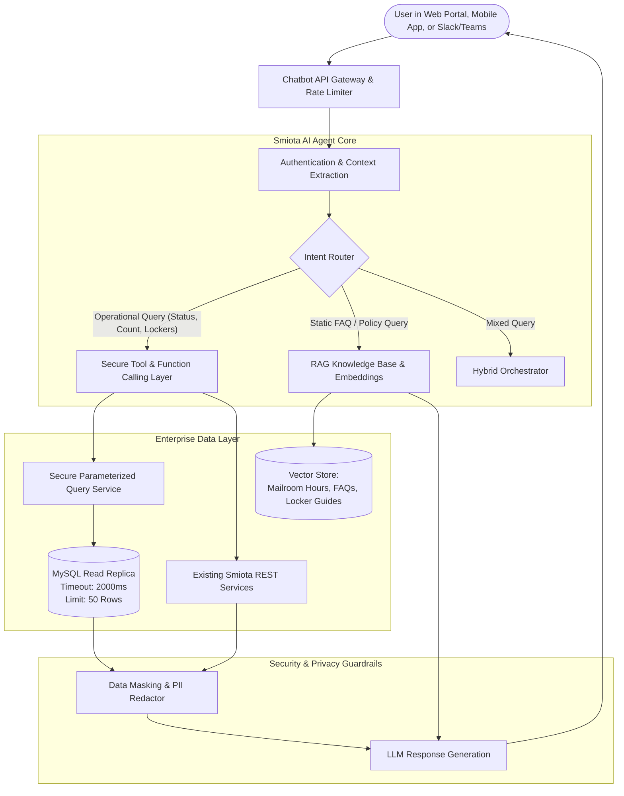
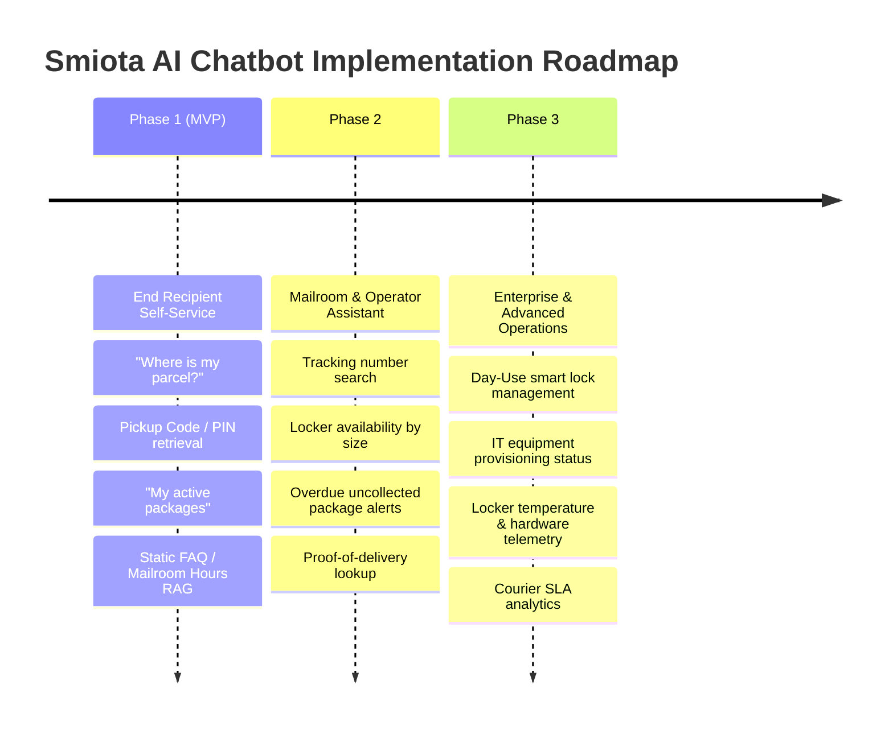

# Smiota AI Chatbot Architecture, High-Priority Query Traces & Implementation Roadmap

## 1. End-to-End Traces for High-Priority Chatbot Intents

### Trace 1: "Where is my parcel?" (End Customer / Recipient)



#### Step-by-Step Data Path
1. **User Authentication & Identity**:
   - The user's JWT or session token is resolved via `user_session` -> `user.ID` (e.g. `1042`).
   - Tenant scope established: `user.CUSTOMER_ID` (5), `user.LOCATION_ID` (12), `user.BUILDING_ID` (3).
2. **Database Query**:
   - Executes `DB.getPackagesInStorage(12, 5, 1042, false)`.
   - Query filters: `WHERE p.customer_id = 5 AND p.recipient_id = 1042 AND (p.is_deleted IS NULL OR p.is_deleted = 0) AND p.is_outbound = 0`.
3. **Status & Readiness Calculation**:
   - `Package.isReadyForRelease()` evaluates each package:
     - If `lockerId > 0`: Located in a smart locker. The query joins `locker` and `locker_unit` to get compartment door number and locker unit name.
     - If `lockerId IS NULL`: Located in the mailroom. Compares `currentlyAtBuildingId` with `intendedForBuildingId`. If equal, it is sitting on the building mailroom shelf. If unequal and currently at a Hub building (`PACKAGE_HUB = 1`), status is reported as "In Transit to your building".
4. **Edge Cases**:
   - **No packages found**: Check `GET /mydeliveredpackages` for packages collected in the last 24 hours ("No active packages awaiting pickup, but you collected a package yesterday at 3:15 PM").
   - **Package on Hold**: If `package.status == 33 (HOLD)`, explain: "Your package is currently on hold by mailroom staff due to an address verification check."
   - **Didn't Fit**: If `package.didnt_fit == true`, explain: "Your package was too large for the smart lockers and is waiting for you at the front desk."

---

### Trace 2: "What is my locker pickup code?" (End Customer / Recipient)

#### Step-by-Step Data Path
1. **Security & Authentication Check**:
   - **Mandatory Guardrail**: The requester **must** be authenticated as the exact recipient of that package (`package.RECIPIENT_ID = ctx.getUser().getId()`). Requests from third parties or unauthenticated sessions are flatly rejected.
2. **Data Retrieval**:
   - Retrieves active packages in status `ATTEMPTED_TO_DELIVER` (4) or `DELIVERED_TO_BUILDING` (1).
   - Reads `package.passcode`. If null, falls back to `user.passcode`.
3. **Passcode Validity Check**:
   - Inspects `user.last_passcode_created_time` against `location_properties.package_passcode_generation` window.
   - If expired, the chatbot triggers an internal passcode refresh before responding.
4. **Response Delivery**:
   - Dispatches pickup code via chat with compartment number and QR collection link:
     *"Your pickup PIN for Locker #14 at the Main Lobby PoD is **582914**. You can also scan this QR code at the kiosk scanner."*

---

### Trace 3: "How many lockers are currently available in Building A?" (Operator / Admin)

#### Step-by-Step Data Path
1. **Authorization**:
   - User must have `LOCATION_ADMIN`, `CUSTOMER_ADMIN`, or `SUPER_USER` role.
2. **Query Execution**:
   - Executes query joining `locker` and `locker_unit`:
     ```sql
     SELECT lu.id as unit_id, lu.name as unit_name, ls.label as size_label,
            COUNT(l.id) as total_lockers,
            SUM(CASE WHEN l.is_in_error_state = 0 AND l.inactive = 0 
                     AND (p.id IS NULL OR p.status = 2) THEN 1 ELSE 0 END) as available_lockers
     FROM locker l
     JOIN locker_unit lu ON l.locker_unit_id = lu.id
     JOIN locker_size ls ON l.size_id = ls.id
     LEFT JOIN package p ON p.locker_id = l.id AND p.status IN (0, 1, 4) AND COALESCE(p.is_deleted, 0) = 0
     WHERE lu.building_id = :buildingId AND lu.customer_id = :customerId
     GROUP BY lu.id, lu.name, ls.label;
     ```
3. **Chatbot Response Synthesis**:
   - Summarizes available capacity by compartment size:
     *"In Building A (Main Tower PoD), there are **24 total lockers available** across 4 sizes:*
     *• Small: 12 available*
     *• Medium: 8 available*
     *• Large: 3 available*
     *• Extra Large: 1 available*
     *All lockers are operational with 0 doors reporting error states."*

---

### Trace 4: "Show proof of delivery for tracking 1Z882910" (Location Admin)

#### Step-by-Step Data Path
1. **Lookup by Tracking Number**:
   - Resolves `package.ID` where `tracking_number = '1Z882910'` and `location_id = :ctxLocationId`.
2. **Release Record Retrieval**:
   - Queries `package_release` and `package_release_blobs`:
     ```sql
     SELECT pr.release_to_name, pr.time_released, pr.id_type, pr.id_number,
            pr.notes, u.first_name as released_by_first, u.last_name as released_by_last,
            CASE WHEN prb.signature IS NOT NULL THEN 1 ELSE 0 END as has_signature,
            CASE WHEN prb.id_photo IS NOT NULL THEN 1 ELSE 0 END as has_photo
     FROM package_release pr
     LEFT JOIN package_release_blobs prb ON pr.package_id = prb.package_id
     LEFT JOIN user u ON pr.released_by_user_id = u.id
     WHERE pr.package_id = :packageId;
     ```
3. **Response Synthesis**:
   - Reports verification details with masked ID:
     *"Package 1Z882910 was released on **October 18 at 4:12 PM** to **John Doe** by mailroom staff **Sarah Connor**.*
     *• ID Verified: Student ID (`STU-*****912`)*
     *• Proof of Delivery: Handwritten digital signature is on file.*
     *• Notes: Picked up in person at front desk."*

---

## 2. Tri-Partite AI Chatbot Architecture



### Component Responsibilities

1. **Deterministic Function-Calling Layer (Operational Data)**:
   - For all live operational queries (package status, compartment availability, pickup PINs, work orders), the LLM **must never generate raw SQL directly against production**.
   - Instead, the LLM selects from a registry of strictly parameterized, pre-compiled tools (e.g., `get_my_active_packages()`, `get_locker_availability(buildingId)`, `lookup_tracking_number(trackingNumber)`).
   - The tool execution service injects the authenticated `customerId`, `locationId`, and `userId` directly from the validated session context.
2. **Retrieval-Augmented Generation (RAG) Layer (Knowledge Base)**:
   - For static policy and informational queries:
     - Mailroom operating hours and holiday schedules
     - Maximum holding period before packages are returned to sender
     - Permitted delivery carriers and courier intake hours
     - How to retrieve packages using the Smiota Urban mobile app
     - What to do if a locker door fails to open or is stuck
     - Prohibited package contents (flammable, perishable, hazardous)
3. **Guardrails & Privacy Defense**:
   - Independent security verification prevents prompt injection attacks from accessing records belonging to other tenants.
   - PII redactor automatically masks government ID numbers, personal phone numbers, and raw password/credential hashes.

---

## 3. Implementation Roadmap



### Phase 1: MVP Core Recipient Experience (Weeks 1–4)
* **Target Audience**: End customers, residents, university students, corporate employees (`RECIPIENT` role).
* **Core Intents**:
  1. `get_my_package_status`: Direct tracking of arriving, held, and delivered parcels.
  2. `get_my_pickup_passcode`: Secure retrieval of 6-digit locker PINs and collection links.
  3. `list_my_uncollected_packages`: Overview of all parcels awaiting collection.
  4. `faq_mailroom_policies`: RAG retrieval for hours of operation, location directions, and pickup rules.
* **Backend Enablers**:
  - Expose a dedicated, lightweight read-only endpoint `/api/v1/chatbot/recipient/packages` that packages `DB.getPackagesInStorage()` with recipient ownership enforcement.

### Phase 2: Mailroom Operator & Facility Staff Assistant (Weeks 5–8)
* **Target Audience**: Mailroom staff, front-desk operators, facility managers (`LOCATION_ADMIN` role).
* **Core Intents**:
  1. `search_package_by_tracking_or_name`: Instant lookup of any parcel across shelves and lockers.
  2. `get_locker_availability_breakdown`: Real-time compartment counts grouped by size (XS, S, M, L, XL).
  3. `list_overdue_uncollected_packages`: Audit report of parcels exceeding 5–7 days in storage.
  4. `get_proof_of_delivery_summary`: Fast verification of handover signatures, timestamps, and staff actors.
* **Backend Enablers**:
  - Implement parameterized read-only service for locker compartment availability.

### Phase 3: Advanced Operations, IT Asset Provisioning & Telemetry (Weeks 9–12)
* **Target Audience**: IT service managers, day-use lock users, maintenance technicians, customer executives.
* **Core Intents**:
  1. `get_it_service_ticket_status`: Status of provisioned/repaired IT hardware in lockers.
  2. `get_day_use_lock_details`: Assigned smart lock numbers, PINs, and battery levels.
  3. `get_refrigerated_locker_temperature_alerts`: Cold-chain compliance and temperature logs.
  4. `get_courier_reconciliation_metrics`: Daily/monthly package volume broken down by carrier (FedEx vs UPS).
* **Backend Enablers**:
  - Integrate with `package_group` IT flow tables and `event_definition_log`.

---

## 4. Open Questions & Assumptions

1. **Database Read Replica**:
   * *Assumption*: A read-only replica of the MySQL production database can be provisioned for chatbot analytic and multi-table queries to avoid placing load on the transactional write database.
   * *Question*: Is a read replica currently available, or should chatbot queries hit the primary c3p0 connection pool?
2. **Chatbot Host Channel**:
   * *Assumption*: The chatbot will initially be embedded as a widget in the Smiota Web Portal (`views/app/`) and potentially in the Smiota mobile app.
   * *Question*: Does the business plan to expose the chatbot via external messaging platforms like Slack, Microsoft Teams, SMS (Twilio), or WhatsApp?
3. **Passcode Display Policy**:
   * *Assumption*: Delivering pickup passcodes directly in chat is acceptable provided the user is strictly authenticated via SSO/JWT.
   * *Question*: Should the chatbot deliver the raw PIN in plain chat text, or provide a one-click authenticated deep-link that reveals the PIN securely inside the portal?
