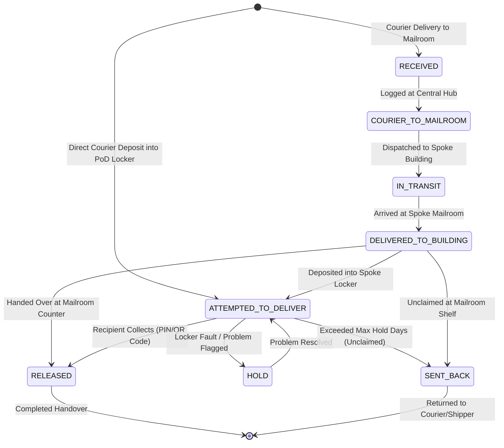
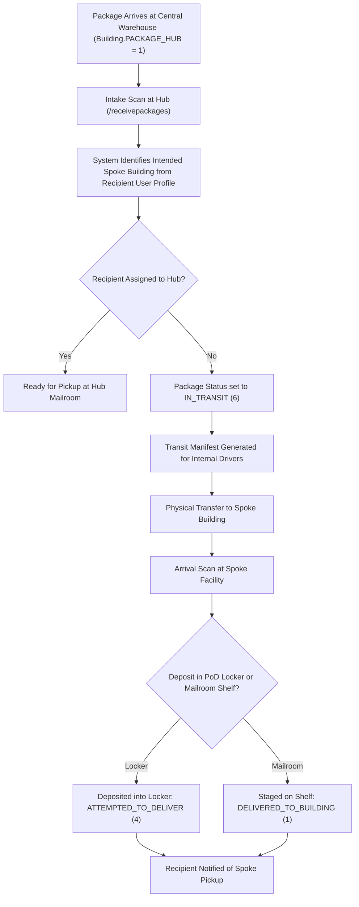
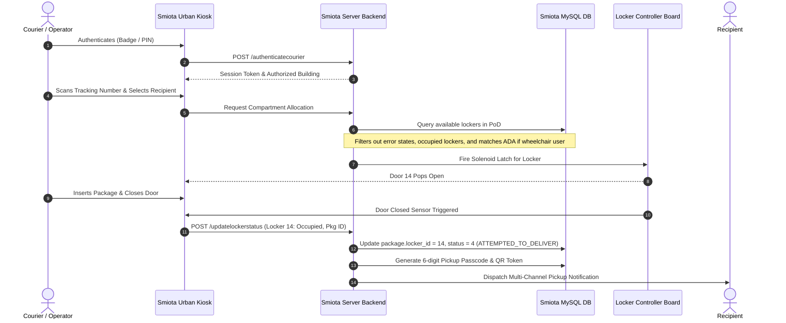
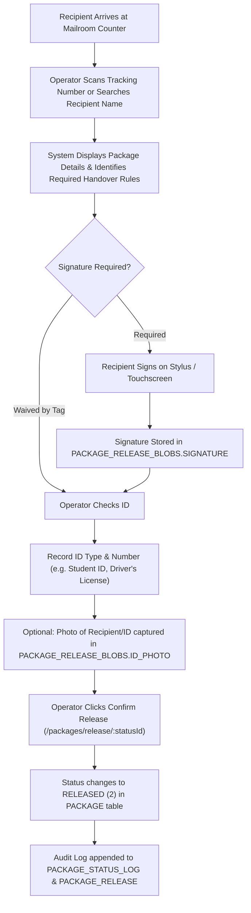
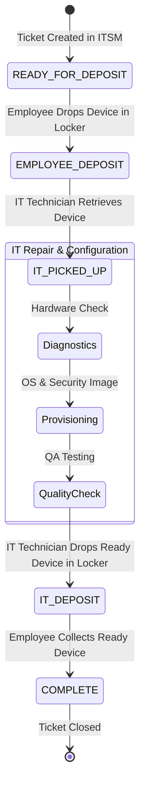
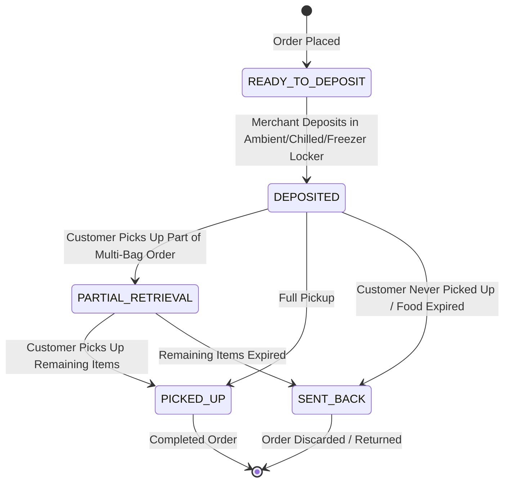
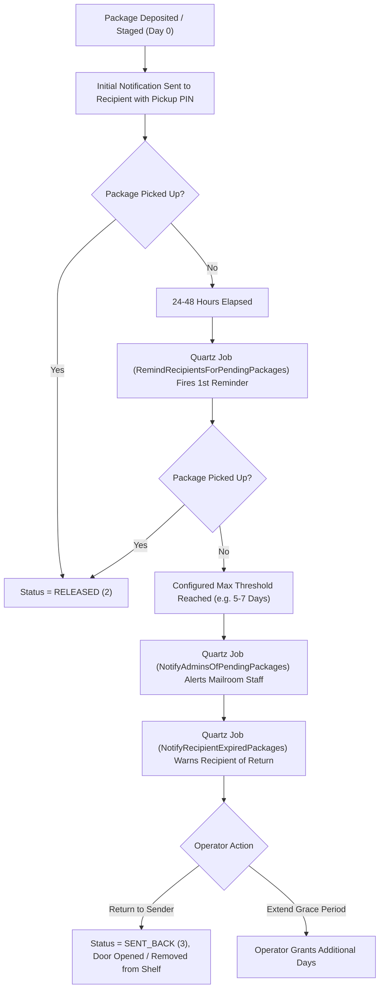
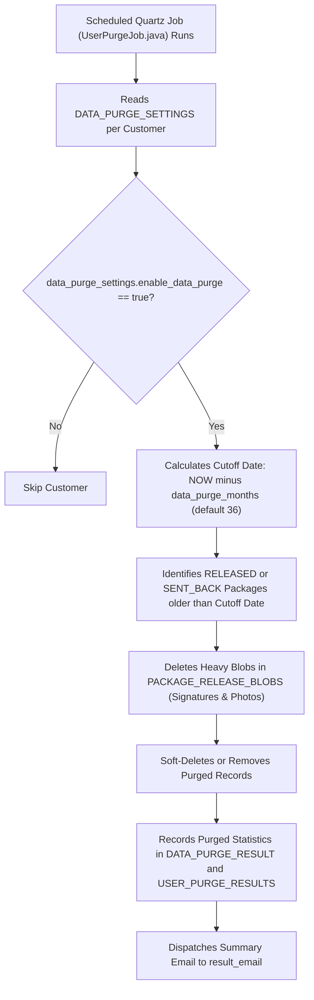

# Smiota Business Workflows & Lifecycle State Machines

This document outlines the core business workflows, state transitions, and operational execution flows discovered in the Smiota Server codebase.

---

## 1. Package Intake, Routing & Release Lifecycle



### Step-by-Step Intake & Processing Logic

1. **Carrier Intake & Scanning**:
   - The courier scans carrier barcodes via mobile terminal or PoD kiosk (`/receivepackageswithtrackingnumber`).
   - The system checks `courier` table or matches tracking pattern (FedEx, UPS, USPS, Amazon).
2. **Recipient & Tenant Matching**:
   - The system attempts exact matching on recipient name, email, or unit number.
   - If not found, fuzzy search evaluates `user` and `tenant` records scoped to `ctx.getUser().getLocationId()`.
3. **Special Handling & Tag Evaluation**:
   - Active tags in `tag` table are evaluated for the recipient:
     - **Vacation Hold**: Package status set to `HOLD` (33); delivery notifications suspended.
     - **Alternate Recipient**: If `alternate_recipient` is designated, notifications route to the proxy recipient.
     - **Alternate Address**: Package flagged for rerouting to another building/location.
     - **Signature Waiver**: If `signature_waived == 1`, mailroom counter staff can bypass physical signature capture.
4. **Deposit vs. Shelf Decision**:
   - If a smart locker is available and the parcel fits dimensions, status becomes `ATTEMPTED_TO_DELIVER` (4).
   - If no locker fits, or all lockers of suitable size are occupied, or parcel is flagged `didntFit == true`, parcel remains in the mailroom shelf at `DELIVERED_TO_BUILDING` (1) or `RECEIVED` (0).
5. **Notification Dispatch**:
   - An entry is created in `package_communication`.
   - `NotifyRecipients.java` dispatches pickup PIN, QR link, and location details via SMS (Twilio), Email (SendGrid), and Push Notification (Firebase).

---

## 2. Hub-and-Spoke Facility Routing Workflow

In large university campuses or corporate facilities, packages arrive at a central receiving warehouse (Hub) and are transported to individual residential halls or office towers (Spokes).



### Readiness Evaluation Rule: `Package.isReadyForRelease()`
The application code in `WEB-INF/src/com/smiota/app/domainmodel/Package.java` (lines 401–407) enforces this exact rule:
```java
public boolean isReadyForRelease() {
    if (isOutbound) 
        return false;
    else
        return (this.atDestination) ? true : 
            (getLockerId() > 0 || getCurrentlyAtBuildingId() == getIntendedForBuildingId());
}
```
* If a package is physically at Building 1 (Hub) but intended for Building 5 (Spoke), `getCurrentlyAtBuildingId() != getIntendedForBuildingId()`, so it is **NOT ready for pickup**, unless the operator sets `atDestination = true`.
* The AI chatbot must check this condition before telling a recipient their package is ready for collection!

---

## 3. Smart Locker Auto-Sizing & Deposition Workflow



---

## 4. Proof-of-Delivery (POD) & Package Handover Workflow

When releasing a package at an attended counter or mailroom desk:



---

## 5. Enterprise IT Equipment Provisioning Workflow (IT Flow)

For corporate customers using Smiota for IT service management (laptops, peripherals, replacement parts):



* **Group Status Mapping**:
  - `Ready for Deposit` (`id = 16`)
  - `Employee Deposit` (`id = 17`)
  - `IT Picked Up` (`id = 18`)
  - `IT Deposit` (`id = 19`)
  - `Complete` (`id = 4`)
* **Endpoint Evidence**: Handled via `GET /ticketsInLocker`, `GET /assignedTickets`, and `GET /api/v1/orders?show=...` in `PackageControllerImpl.java` (lines 1266–1287).

---

## 6. Food & Dining / Retail (BOPIS) Workflow

For grocery, campus dining, and retail customers with temperature-sensitive deliveries:



* **Temperature Monitoring**: Refrigerator/Freezer lockers are continuously monitored via `TemperatureEventJob.java`. If temperature rises above `event_definition.max_value`, alerts are immediately dispatched to facility managers.

---

## 7. Automated Reminders & Expiration Workflow



---

## 8. Automated Data Purge Lifecycle

To comply with data privacy policies and optimize database storage:


