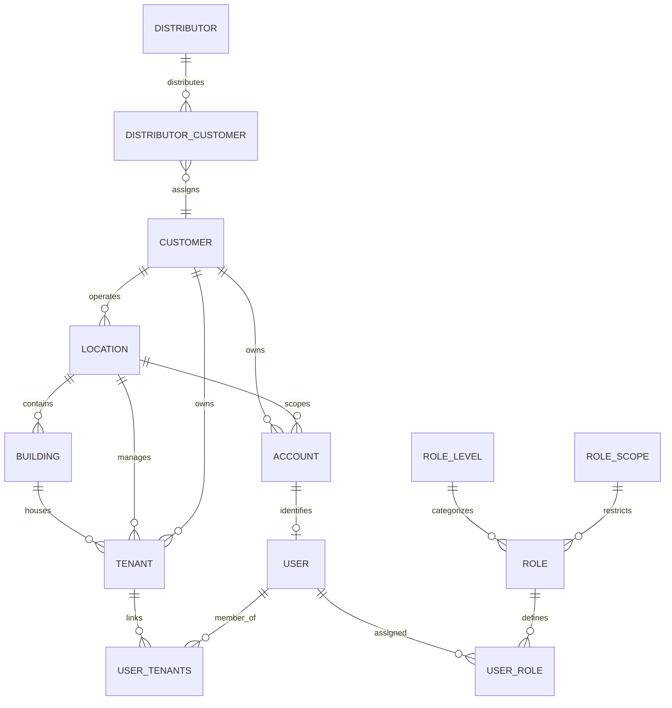
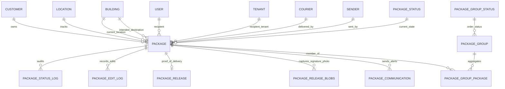
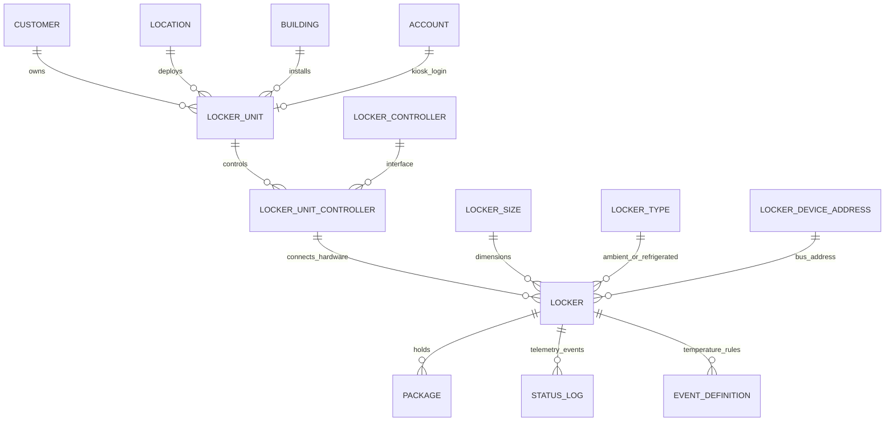
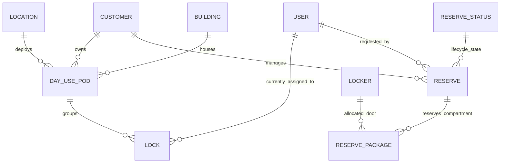

# Smiota Database Schema & Entity Relationship Architecture

## Executive Schema Summary

The Smiota Server database was reconstructed from 220 sequential database migration scripts (`v26.sql` through `v223.sql` in `WEB-INF/db/mysql_migration/`), database procedure files (`WEB-INF/db/procedure/`), and baseline DDL definitions consolidated in `consolidated_schema.sql`.

The relational database runs on **MySQL 8.0+ / MariaDB 10.3+** with default character set `utf8mb4` and collation `utf8mb4_unicode_ci`. It contains **173 active tables** structured into 15 logical domain clusters.

---

## High-Level Domain ER Diagrams

### 1. Organization, Tenancy & Location Hierarchy

### 2. Package Intake, Custody & Release Lifecycle

### 3. Smart Locker Hardware (PoD) Infrastructure

### 4. Day-Use Smart Locks & Locker Reservations

---

## Comprehensive Table Catalog by Domain Cluster

### Domain Cluster 1: Multi-Tenancy, Hierarchy & Facility Structure

| Table Name | Primary Purpose | Primary Key | Critical Foreign Keys | Soft-Delete / Status Flags |
| :--- | :--- | :--- | :--- | :--- |
| `customer` | Top-level enterprise tenant (University, Corporate, Property Mgmt). | `ID` (bigint) | None (Top-level root) | `inactive` (tinyint), `test_customer` |
| `location` | Physical site/campus operating lockers or mailrooms. | `ID` (bigint) | `CUSTOMER_ID` -> `customer(ID)` | `inactive` (tinyint) |
| `location_properties` | Operational rules per location (BOPIS, IT flow, passcodes, reminders). | `id` (bigint) | `location_id` -> `location(ID)` | `is_it_flow`, `is_bopis`, `is_package_flow` |
| `building` | Distinct building within a location. Can be a Hub or Spoke building. | `ID` (bigint) | `LOCATION_ID` -> `location(ID)` | `INACTIVE` (tinyint), `PACKAGE_HUB` (tinyint) |
| `delivery_building` | Cross-building routing table for delivery assignments. | `ID` (bigint) | `BUILDING_ID`, `DELIVERY_BUILDING_ID` | None |
| `tenant` | Tenant entity (company, suite, apartment) within a building/location. | `ID` (bigint) | `LOCATION_ID` -> `location(ID)`, `CUSTOMER_ID` -> `customer(ID)`, `BUILDING_ID` -> `building(ID)` | `INACTIVE` (tinyint) |
| `user_tenants` | Many-to-many relationship mapping users/recipients to tenants. | `id` (bigint) | `user_id` -> `user(ID)`, `tenant_id` -> `tenant(ID)` | None |
| `distributor` | Third-party reseller/distributor managing multiple customers. | `id` (bigint) | None | `inactive` (tinyint) |
| `distributor_customer`| Mapping table linking distributors to assigned customers. | `id` (bigint) | `distributor_id`, `customer_id` | None |

### Domain Cluster 2: Identity, Accounts, Authentication & RBAC

| Table Name | Primary Purpose | Primary Key | Critical Foreign Keys | Soft-Delete / Status Flags |
| :--- | :--- | :--- | :--- | :--- |
| `account` | Kiosk, user, or service login credentials and security tokens. | `ID` (bigint) | `CUSTOMER_ID` -> `customer(ID)`, `LOCATION_ID` -> `location(ID)` | `INACTIVE`, `IS_LOCKED`, `is_deleted` |
| `user` | Core user entity (recipients, mailroom staff, admins, couriers). | `ID` (bigint) | `CUSTOMER_ID` -> `customer(ID)`, `LOCATION_ID` -> `location(ID)`, `TENANT_ID` -> `tenant(ID)`, `BUILDING_ID` -> `building(ID)` | `INACTIVE`, `is_deleted`, `opt_out`, `wheel_chair_access` |
| `role` | Standard system roles (`SUPER_USER`, `LOCATION_ADMIN`, `RECIPIENT`, etc.). | `ID` (int) | `ROLE_LEVEL_ID` -> `role_level(ID)` | None (Lookup table) |
| `role_level` | Classification of roles (`SYSTEM`, `ADMIN`, `MANAGER`, `WORKER`, `REPORTER`). | `ID` (int) | None | Lookup table |
| `role_scope` | Defines hierarchical restriction (`LOCATION`, `CUSTOMER`, `SHIFT`, `TENANT`). | `id` (int) | None | Lookup table |
| `user_role` | Many-to-many role assignments with optional scoping UUIDs. | `id` (bigint) | `user_id` -> `user(ID)`, `role_id` -> `role(ID)` | None |
| `user_session` | Active authentication sessions, tokens, and expiry timestamps. | `ID` (bigint) | `USER_ID` -> `user(ID)` | `IS_EXPIRED` (tinyint) |
| `security_card` | Physical RFID/NFC security badge mapping for login. | `ID` (bigint) | None | `inactive` (tinyint) |
| `auth_config` | SSO & SAML configuration per customer (Entity ID, metadata URL). | `id` (bigint) | `customer_id` -> `customer(ID)` | `inactive` (tinyint) |
| `oauth2_code_grants` | OAuth 2.0 authorization code grants. | `id` (bigint) | `client_id` -> `account(client_id)` | `is_expired` (tinyint) |

### Domain Cluster 3: Packages, Parcels & Mailroom Operations

| Table Name | Primary Purpose | Primary Key | Critical Foreign Keys | Soft-Delete / Status Flags |
| :--- | :--- | :--- | :--- | :--- |
| `package` | Master record for individual parcel, mailpiece, or provisioned item. | `ID` (bigint) | `CUSTOMER_ID`, `LOCATION_ID`, `BUILDING_ID`, `RECIPIENT_ID`, `TENANT_ID`, `LOCKER_ID`, `COURIER_ID`, `SENDER_ID` | `is_deleted` (tinyint), `is_outbound`, `didnt_fit`, `at_destination` |
| `package_status` | Master status lookup (-1: Requested, 0: Received, 1: Delivered to Building, 2: Released, 3: Sent Back, 4: Attempted, 5: Courier to Mailroom, 6: In Transit, 7: Return to Hub, 30: Ready to Ship, 31: In Transit to Warehouse, 32: In Transit to PoD, 33: Hold, 34: In Warehouse). | `id` (int) | None | Core status enumeration |
| `package_status_assignment` | Customer/Location-specific custom labels and color codes for statuses. | `id` (int) | `status_id` -> `package_status(id)`, `customer_id`, `location_id` | None |
| `package_status_log` | Immutable chronological audit trail of all package status transitions. | `ID` (bigint) | `PACKAGE_ID` -> `package(ID)`, `PACKAGE_STATUS_ID` -> `package_status(id)`, `UPDATED_BY_USER_ID` -> `user(ID)` | None (Append-only audit) |
| `package_edit_log` | Detailed audit log capturing serialized JSON of edited package fields. | `id` (bigint) | `package_id` -> `package(ID)`, `updated_by_user_id` -> `user(ID)` | None (Append-only audit) |
| `package_release` | Release transaction record documenting package pickup/handover. | `ID` (bigint) | `PACKAGE_ID` -> `package(ID)`, `RELEASE_TO_USER_ID` -> `user(ID)`, `RELEASED_BY_USER_ID` -> `user(ID)` | None |
| `package_release_blobs` | Binary proof-of-delivery storage (handwritten signature, ID photo). | `ID` (bigint) | `PACKAGE_ID` -> `package(ID)`, `PACKAGE_STATUS_LOG_ID` -> `package_status_log(ID)` | None |
| `package_advanced_properties`| Extended package attributes (dimensions, weight, special handling). | `id` (bigint) | `package_id` -> `package(ID)` | None |
| `courier` | Courier carrier definitions (FedEx, UPS, USPS, Amazon, DHL, OnTrac, etc.). | `ID` (bigint) | None | `inactive` (tinyint) |
| `courier_user` | Authorized individual drivers/couriers associated with a carrier. | `id` (bigint) | `courier_id` -> `courier(ID)`, `user_id` -> `user(ID)` | None |
| `sender` | Package originating senders (retailers, vendors, shippers). | `id` (bigint) | `customer_id` -> `customer(ID)`, `location_id` -> `location(ID)` | `is_deleted` (tinyint) |
| `package_type` | Package classification types (Parcel, Envelope, Dry Cleaning, Box). | `ID` (int) | None | Lookup table |
| `customer_package_type` | Custom package type overrides and labels per customer/location. | `id` (bigint) | `customer_id`, `location_id`, `package_type_id` | None |

### Domain Cluster 4: Orders & Package Groups (IT & BOPIS Workflows)

| Table Name | Primary Purpose | Primary Key | Critical Foreign Keys | Soft-Delete / Status Flags |
| :--- | :--- | :--- | :--- | :--- |
| `package_group` | Multi-package grouping representing an Order or IT Service Ticket. | `id` (bigint) | `customer_id` -> `customer(ID)`, `location_id` -> `location(ID)` | `is_deleted` (tinyint), `is_it_flow` |
| `package_group_package` | Many-to-many bridge linking individual packages to a package group. | `id` (bigint) | `package_group_id` -> `package_group(id)`, `package_id` -> `package(ID)` | None |
| `package_group_status` | Master status lookup for orders/tickets (1: Deposited, 3: Partial Retrieval, 4: Complete/Picked Up, 9: Sent Back, 16: Ready for Deposit, 17: Employee Deposit, 18: IT Picked Up, 19: IT Deposit). | `id` (bigint) | None | State enumeration |
| `package_group_status_log` | Audit history of order/ticket lifecycle transitions. | `id` (bigint) | `package_group_id`, `package_group_status_id`, `updated_by_user_id` | Append-only audit |
| `package_group_status_transition` | Permitted state machine transitions for package groups. | `id` (bigint) | `from_status_id`, `to_status_id` | Workflow engine |

### Domain Cluster 5: Smart Lockers & Hardware Infrastructure (PoD)

| Table Name | Primary Purpose | Primary Key | Critical Foreign Keys | Soft-Delete / Status Flags |
| :--- | :--- | :--- | :--- | :--- |
| `locker_unit` | Hardware kiosk bank (Point of Distribution / PoD). | `ID` (bigint) | `BUILDING_ID` -> `building(ID)`, `LOCATION_ID` -> `location(ID)`, `CUSTOMER_ID` -> `customer(ID)`, `ACCOUNT_ID` -> `account(ID)` | `INACTIVE` (tinyint), `magic_box_available` |
| `locker_unit_config` | Software and UI configuration for locker kiosk (timeouts, screen saver). | `id` (bigint) | `locker_unit_id` -> `locker_unit(ID)` | Multiple app flags |
| `locker_controller` | Master controller board definition (serial, firmware, vendor). | `ID` (int) | `LOCKER_CONTROLLER_TYPE_ID` -> `locker_controller_type(ID)` | None |
| `locker_unit_controller` | Bridge mapping controllers to physical locker units with IP/Port. | `ID` (bigint) | `LOCKER_UNIT_ID` -> `locker_unit(ID)`, `LOCKER_CONTROLLER_ID` -> `locker_controller(ID)` | None |
| `locker` | Individual physical compartment/door in a locker bank. | `ID` (bigint) | `UNIT_CONTROLLER_ID` -> `locker_unit_controller(ID)`, `SIZE_ID` -> `locker_size(ID)`, `TYPE_ID` -> `locker_type(ID)` | `INACTIVE`, `IS_OPEN`, `IS_IN_ERROR_STATE`, `ADA_COMPLIANT`, `DO_NOT_DETECT_PRESENCE` |
| `locker_size` | Size classifications (XS, S, M, L, XL, Custom). | `ID` (bigint) | `LOCKER_DIMENSION_ID` -> `locker_dimension(ID)` | Lookup table |
| `locker_type` | Environmental type (Ambient, Refrigerated, Freezer, Heated). | `ID` (int) | None | Lookup table |
| `locker_device_address` | Low-level bus and relay address for electronic door latches. | `id` (bigint) | `locker_unit_id` -> `locker_unit(ID)` | `inactive` (bit) |
| `status_log` | Telemetry logs received from locker units (pings, open/close, errors). | `ID` (bigint) | `LOCKER_ID` -> `locker(ID)`, `LOCKER_UNIT_ID` -> `locker_unit(ID)`, `CUSTOMER_ID` -> `customer(ID)` | Telemetry stream |
| `beacon` / `beacon_global` | Bluetooth Low Energy (BLE) beacons installed near lockers for contactless app proximity. | `ID` (bigint) | `BUILDING_ID`, `LOCATION_ID`, `LOCKER_UNIT_ID` | `inactive` (tinyint) |

### Domain Cluster 6: Day-Use Smart Locks & Locker Reservations

| Table Name | Primary Purpose | Primary Key | Critical Foreign Keys | Soft-Delete / Status Flags |
| :--- | :--- | :--- | :--- | :--- |
| `lock` | Standalone battery-powered smart lock attached to day-use lockers. | `id` (bigint) | `customer_id` -> `customer(ID)`, `day_use_pod_id` -> `day_use_pod(id)`, `assigned_to` -> `user(ID)` | `inactive` (tinyint), `battery_percentage`, `is_wheelchair_accessible` |
| `day_use_pod` | Facility bank grouping day-use smart locks. | `id` (bigint) | `customer_id`, `location_id`, `building_id` | `inactive` (tinyint) |
| `reserve` | Locker reservation record made by user or external system. | `id` (bigint) | `customer_id`, `location_id`, `user_id`, `status_id` -> `reserve_status(id)` | `is_deleted` (tinyint) |
| `reserve_package` | Mapping linking reserved lockers to packages or commodities. | `id` (bigint) | `reserve_id` -> `reserve(id)`, `locker_id` -> `locker(ID)` | None |
| `reserve_status` | Reservation states: `HOLD`, `CONFIRMED`, `CANCELLED`, `COMPLETE`. | `id` (varchar) | None | UUID-based lookup |
| `reserve_log` | Audit history of reservation modifications and cancellations. | `id` (bigint) | `reserve_id` -> `reserve(id)`, `updated_by` -> `user(ID)` | Audit log |

### Domain Cluster 7: Communications, Notifications & Delivery Alerts

| Table Name | Primary Purpose | Primary Key | Critical Foreign Keys | Soft-Delete / Status Flags |
| :--- | :--- | :--- | :--- | :--- |
| `package_communication` | Central log of notifications sent for packages. | `ID` (bigint) | `PACKAGE_ID` -> `package(ID)`, `CUSTOMER_ID` -> `customer(ID)` | None |
| `package_communication_sms` | Twilio SMS logs (recipient phone, message body, status, sent time). | `ID` (bigint) | `CUSTOMER_ID` -> `customer(ID)`, `STATUS` -> `package_communication_status(ID)` | Provider delivery status |
| `package_communication_email` | SendGrid / SMTP email delivery logs and body text. | `ID` (bigint) | `CUSTOMER_ID` -> `customer(ID)`, `STATUS` -> `package_communication_status(ID)` | Provider delivery status |
| `package_communication_app` | Firebase Cloud Messaging (FCM) push notifications sent to mobile. | `ID` (bigint) | `CUSTOMER_ID` -> `customer(ID)`, `STATUS` -> `package_communication_status(ID)` | Provider delivery status |
| `package_communication_voice` | Twilio voice call notifications sent to landlines/recipients. | `id` (bigint) | `customer_id` -> `customer(ID)`, `status` -> `package_communication_status(ID)` | Call completion status |
| `scheduled_reminders_results` | Results log of automated periodic reminder notifications sent for uncollected packages. | `id` (bigint) | `customer_id`, `location_id` | Records recipient counts |
| `notification_control` | Delivery rules controlling whether alerts route to actual recipient, delegate, or alternate. | `id` (int) | `tag_id` -> `tag(id)` | `to_actual_recipient`, `to_delegated_recipient`, `to_alternate_recipient` |

### Domain Cluster 8: Tags, Forwarding & Special Handling

| Table Name | Primary Purpose | Primary Key | Critical Foreign Keys | Soft-Delete / Status Flags |
| :--- | :--- | :--- | :--- | :--- |
| `tag` | Special handling rules applied to User, Package, or Sender. | `id` (int) | `customer_id`, `location_id`, `tag_type_id`, `tag_option_id`, `recipient_id` | `inactive` (bit), `start_time`, `end_time` |
| `tag_type` | Tag entity category (1: User, 2: Package, 3: Sender). | `id` (int) | None | Lookup table |
| `tag_option` | Handling logic (Notes Only, Alternate Recipient, Alternate Address). | `id` (int) | `tag_type_id` -> `tag_type(id)` | Lookup table |
| `alternate_recipient` | Designated substitute recipient when a user is on vacation/leave. | `id` (bigint) | `tag_id` -> `tag(id)`, `alternate_recipient_id` -> `user(ID)` | None |
| `alternate_address` | Alternate physical building/location to forward parcels to. | `id` (bigint) | `tag_id` -> `tag(id)`, `alternate_building_id` -> `building(ID)` | None |

### Domain Cluster 9: Maintenance & Service Work Orders

| Table Name | Primary Purpose | Primary Key | Critical Foreign Keys | Soft-Delete / Status Flags |
| :--- | :--- | :--- | :--- | :--- |
| `maint_type` | Category of maintenance work (Locker Repair, Cleaning, Inspection). | `id` (bigint) | None | `inactive` (tinyint) |
| `maint_frequency` | Recurrence frequency (Daily, Weekly, Monthly, Quarterly, Annual). | `id` (bigint) | None | Lookup table |
| `maint_location` | Physical location and building where maintenance is scheduled. | `id` (bigint) | `customer_id`, `location_id`, `building_id`, `maint_type_id` | `inactive` (tinyint) |
| `maint_schedule` | Scheduled service dates, time windows, and completion status. | `id` (bigint) | `maint_location_id` -> `maint_location(id)` | `is_completed` (tinyint) |
| `maint_service` | Executed maintenance service record performed by a technician. | `id` (bigint) | `maint_schedule_id`, `worker_user_id` -> `user(ID)` | Completion status |
| `maint_task` | Checklist tasks associated with a maintenance type. | `id` (bigint) | `maint_type_id` -> `maint_type(id)` | None |
| `maint_service_task` | Execution status of specific tasks during a service session. | `id` (bigint) | `maint_service_id` -> `maint_service(id)`, `maint_task_id` -> `maint_task(id)` | `is_passed`, `notes` |

### Domain Cluster 10: Inventory & Spare Parts Management

| Table Name | Primary Purpose | Primary Key | Critical Foreign Keys | Soft-Delete / Status Flags |
| :--- | :--- | :--- | :--- | :--- |
| `product` | Catalog of replacement parts, hardware components, or assets. | `id` (bigint) | `customer_id` -> `customer(ID)` | `is_deleted` (tinyint) |
| `product_inventory` | Individual serialized inventory items with MAC address/serial. | `id` (bigint) | `product_id` -> `product(id)`, `status_id` -> `product_inventory_status(id)` | `serial_number`, `mac_address` |
| `product_inventory_status`| Status lookup: ORDERED (1), RECEIVED_INTO_INVENTORY_ROOM (2), RELEASED_FROM_INVENTORY_ROOM (3), RELEASED_TO_SERVICE_ROOM (4). | `id` (bigint) | None | Status enumeration |
| `product_inventory_status_log`| Audit trail of inventory custody changes and part movements. | `id` (bigint) | `product_inventory_id`, `status_id`, `updated_by` -> `user(ID)` | Append-only audit |
| `product_package` | Links inventory products to tracked packages in transit. | `id` (bigint) | `product_id` -> `product(id)`, `package_id` -> `package(ID)` | None |
| `maint_task_product` | Parts consumed or required during maintenance tasks. | `id` (bigint) | `maint_task_id`, `product_id` | None |

### Domain Cluster 11: Shifts & Staffing Management

| Table Name | Primary Purpose | Primary Key | Critical Foreign Keys | Soft-Delete / Status Flags |
| :--- | :--- | :--- | :--- | :--- |
| `shift` | Work shift definitions for buildings/locations with scheduled hours. | `id` (bigint) | `customer_id`, `location_id`, `building_id`, `created_by` | `inactive` (tinyint), `is_deleted` (tinyint), `days_of_week` |
| `shift_asset` | Physical assets or equipment tags assigned to a shift. | `id` (bigint) | `shift_id` -> `shift(id)` | `asset_tag` (varchar) |

### Domain Cluster 12: IoT Telemetry & Temperature Monitoring

| Table Name | Primary Purpose | Primary Key | Critical Foreign Keys | Soft-Delete / Status Flags |
| :--- | :--- | :--- | :--- | :--- |
| `event` | Master catalog of system and sensor event types. | `id` (int) | None | Lookup table |
| `event_definition` | Configured alert thresholds (min/max temperature, timeout limits). | `id` (bigint) | `event_id`, `locker_id`, `locker_unit_id`, `location_id`, `customer_id` | `inactive` (bit), `min_value`, `max_value` |
| `event_definition_log`| Historical log of triggered alerts and sensor threshold breaches. | `id` (bigint) | `event_definition_id`, `locker_id`, `customer_id` | Timestamped event stream |
| `temperature_unit` | Temperature scale definitions (Fahrenheit, Celsius). | `id` (int) | None | Lookup table |

### Domain Cluster 13: Enterprise Integrations & Sync Protocols

| Table Name | Primary Purpose | Primary Key | Critical Foreign Keys | Soft-Delete / Status Flags |
| :--- | :--- | :--- | :--- | :--- |
| `integration_type` | Supported external systems (ResMan, Entrata, Google Directory, SCLogic, AfterShip, Tesla, CSV, SCIM). | `ID` (int) | None | Lookup table |
| `integration_parmeter_definition`| Configuration schema definition per integration type. | `id` (int) | `type` -> `integration_type(ID)` | Parameter schema |
| `integration_parameter_value` | Stored credentials, API keys, URLs, and sync flags per customer/location. | `id` (bigint) | `parameter_definition_id`, `customer_id`, `location_id` | Encrypted or plain parameters |
| `integration_status` | Execution status and logs of integration synchronization runs. | `id` (bigint) | `integration_type_id`, `customer_id`, `location_id` | Execution state |
| `integration_retry` | Dead-letter queue for failed webhook calls and sync operations. | `id` (bigint) | `integration_type_id` | Retry counters |
| `scim_user` / `scim_group` | SCIM 2.0 user and group mapping tables for Okta/Azure AD sync. | `id` (bigint) | `user_id` -> `user(ID)` | SCIM metadata |

### Domain Cluster 14: Data Retention, Purging & Audit Logs

| Table Name | Primary Purpose | Primary Key | Critical Foreign Keys | Soft-Delete / Status Flags |
| :--- | :--- | :--- | :--- | :--- |
| `data_purge_settings` | Customer policies for historical package and user data retention (months). | `id` (bigint) | `customer_id` -> `customer(ID)` | `enable_data_purge`, `data_purge_months` (default 36) |
| `data_purge_result` | Audit summary of automated data purge runs. | `id` (bigint) | `customer_id` -> `customer(ID)` | Records purged counts |
| `user_purge_results` | Audit summary of deactivated/purged users. | `id` (bigint) | `customer_id` -> `customer(ID)` | Records user counts |
| `admin_dashboard_log`| Audit tracking of administrator logins and dashboard operations. | `id` (bigint) | `user_id` -> `user(ID)`, `customer_id` | Timestamped audit |

### Domain Cluster 15: Configuration, Versioning & System Metadata

| Table Name | Primary Purpose | Primary Key | Critical Foreign Keys | Soft-Delete / Status Flags |
| :--- | :--- | :--- | :--- | :--- |
| `version` | Migration version tracking table. | `ID` (int) | None | Tracks current schema version (223) |
| `config_props` | Registered system configuration property definitions. | `id` (bigint) | None | Property schema |
| `config_values` | Customer and location overrides for registered configuration properties. | `id` (bigint) | `config_prop_id` -> `config_props(id)`, `customer_id`, `location_id` | Property values |
| `system_properties` | Global server settings and system feature flags. | `ID` (int) | None | Key-value pairs |
| `meta_object` / `meta_field` | Legacy dynamic schema metadata tables (v2–v26). | `ID` (bigint) | None | Obsolete metadata engine |

---

## Explicit vs Implicit Relationships Analysis

### Verified Explicit Foreign Keys (Database-Enforced)

The Smiota MySQL schema defines extensive explicit `FOREIGN KEY` constraints with `REFERENCES`:
1. `account.CUSTOMER_ID` -> `customer.ID`
2. `account.SECURITY_CARD_ID` -> `security_card.ID`
3. `location.CUSTOMER_ID` -> `customer.ID`
4. `building.LOCATION_ID` -> `location.ID`
5. `tenant.LOCATION_ID` -> `location.ID`, `tenant.CUSTOMER_ID` -> `customer.ID`, `tenant.BUILDING_ID` -> `building.ID`
6. `user_tenants.user_id` -> `user.ID`, `user_tenants.tenant_id` -> `tenant.ID`
7. `user_role.user_id` -> `user.ID`, `user_role.role_id` -> `role.ID`
8. `package_status_log.PACKAGE_ID` -> `package.ID`, `package_status_log.UPDATED_BY_USER_ID` -> `user.ID`
9. `package_release.PACKAGE_ID` -> `package.ID` (`ON DELETE CASCADE`), `package_release.RELEASED_BY_USER_ID` -> `user.ID`
10. `package_release_blobs.PACKAGE_ID` -> `package.ID`, `package_release_blobs.PACKAGE_STATUS_LOG_ID` -> `package_status_log.ID`
11. `locker_unit.LOCATION_ID` -> `location.ID`, `locker_unit.BUILDING_ID` -> `building.ID`, `locker_unit.CUSTOMER_ID` -> `customer.ID`
12. `locker_unit_controller.LOCKER_UNIT_ID` -> `locker_unit.ID`, `locker_unit_controller.LOCKER_CONTROLLER_ID` -> `locker_controller.ID`
13. `lock.assigned_to` -> `user.ID`, `lock.customer_id` -> `customer.ID`, `lock.day_use_pod_id` -> `day_use_pod.id`

### Critical Implicit Relationships (Application-Enforced in Java Code)

Several critical business relationships exist only in Java DAO queries (`DB.java`, `PackageDaoImpl.java`, `UserDaoImpl.java`) without database-level constraints:
1. **`package.RECIPIENT_ID` -> `user.ID`**: The `package` table has a `KEY` index on `RECIPIENT_ID`, but intentionally omits a database `FOREIGN KEY` constraint to prevent cascade deletions or blocking user deactivations. The join is performed in application SQL (`LEFT JOIN user u ON p.RECIPIENT_ID = u.ID`).
2. **`package.LOCKER_ID` -> `locker.ID`**: Indexed but joined in application queries without a hard FK constraint to ensure packages remain intact if a locker hardware record is reconfigured or replaced.
3. **`user.ACCOUNT_ID` -> `account.ID`**: Often joined implicitly via `user.LOGIN = account.LOGIN` or `user.ACCOUNT_ID = account.ID`.
4. **`package.TENANT_ID` -> `tenant.ID`**: Indexed and resolved via application code during intake and package query filters.
5. **`package.COURIER_ID` -> `courier.ID`**: Resolved in code; fallback text name stored in `package.COURIER`.
6. **`user_role.scope_id` -> Multiple Entities**: When `user_role.scope` is set to `LOCATION`, `scope_id` references `location.UUID`; when set to `SHIFT`, `scope_id` references `shift.UUID`. This polymorphic relationship cannot be enforced by a single database foreign key.

---

## Soft-Delete, Audit & Freshness Patterns

| Pattern | Implemented Columns | Application Behavior |
| :--- | :--- | :--- |
| **Soft Delete** | `is_deleted` (tinyint), `COALESCE(is_deleted, 0) = 0` | Applied across `package`, `user`, `account`, `customer`, `sender`, `shift`, `package_group`, `product`. Queries must explicitly include `WHERE (is_deleted IS NULL OR is_deleted = 0)`. |
| **Deactivation** | `inactive` (tinyint / bit), `COALESCE(inactive, 0) = 0` | Applied across `location`, `building`, `tenant`, `locker`, `locker_unit`, `lock`, `day_use_pod`, `courier`. Indicates operational suspension without deletion. |
| **Audit Timestamps** | `created_at`, `created_time`, `last_modified_time`, `last_modified_at` | Timestamps automatically updated on insert/update. Most tables also capture `created_by` / `updated_by` referencing `user.ID`. |
| **Status Change Audit**| `package_status_log`, `package_edit_log`, `product_inventory_status_log`, `event_definition_log` | Immutable append-only transaction logs preserving historical timestamps, changing actor ID, previous/next states, and hardware details. |
| **Data Retention Limits**| `data_purge_settings.data_purge_months` | Automated Quartz job (`UserPurgeJob.java`, `BackupServiceJob.java`) purges historical packages and inactive users exceeding retention thresholds (default: 36 months / 3 years). |
