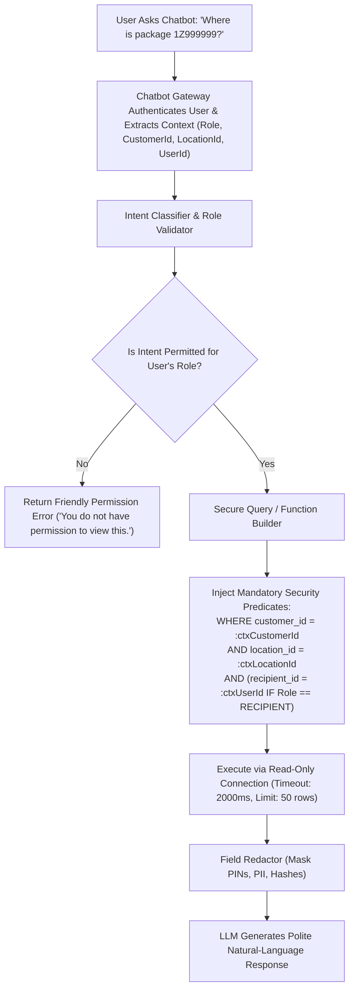

# Smiota Security, Multi-Tenancy & Access Control

## 1. Multi-Tenancy Architecture & Scope Resolution

Smiota Server enforces a hierarchical multi-tenant architecture designed to partition data across distributors, customers, locations, buildings, and tenants:

```
Distributor (Optional Reseller)
  └── Customer (Enterprise Client / University / Corporate / Residential PM)
        └── Location (Physical Facility / Campus Site)
              ├── Building (Hub or Spoke Facility)
              │     ├── Tenant (Apartment Unit / Company Suite / Department)
              │     │     └── User / Recipient
              │     └── LockerUnit (PoD Kiosk / Hardware Terminal)
              │           └── Locker (Physical Compartment)
              └── DayUsePod
                    └── Lock (Smart Lock Hardware)
```

### Context & Session Resolution
Every incoming HTTP request to Smiota Server passes through the global `Spark.before()` filter in `WEB-INF/src/com/smiota/app/MainApplication.java` (lines 349–447). 

1. **Authentication Verification**:
   - The filter inspects HTTP headers or query parameters for `token` (`UUID`).
   - `controller.getContext(request)` queries the `user_session` table joining with `account` and `user`.
   - The populated `Context` object encapsulates the authenticated `User`, their `Customer`, their primary `Location`, their active `Building`, and their `Set<String> roles`.
2. **Context Switching**:
   - Multi-location administrators can move session context between managed locations via `POST /movesession` without re-entering credentials.
3. **Session Expiry & Invalidation**:
   - Checked via `controller.checkUpdateExpiration(ctx)`. Token expiration is evaluated against `account.session_timeout` (default 30–60 minutes).
   - If expired, `401 Unauthorized` is returned and the session is invalidated.

---

## 2. Role-Based Access Control (RBAC) Matrix

Smiota defines **19 distinct roles** across 6 hierarchical levels (`role_level`):

| Role ID | Role Enum | Hierarchy Level | System Description | Chatbot Data Scope & Capabilities |
| :---: | :--- | :--- | :--- | :--- |
| **1** | `SUPER_USER` | `SYSTEM` (1) | Global Smiota Engineering & Operations staff. | Global read/write across all customers, locations, and hardware. Full system diagnostic access. |
| **2** | `CUSTOMER_ADMIN` | `ADMIN` (2) | Enterprise client administrator (e.g., Campus VP). | Full access to all locations, buildings, lockers, and reports belonging to their `customer_id`. |
| **3** | `LOCATION_ADMIN` | `ADMIN` (2) | Site-level facility or mailroom operations manager. | Full operational visibility within their assigned `location_id`. Can search all packages, lockers, recipients, and logs. |
| **4** | `RECIPIENT` | `WORKER` (5) | End customer, resident, student, or employee. | **Strictly Self-Service**: Can **ONLY** view packages addressed to their own `user_id` (`package.RECIPIENT_ID = user.ID`). Cannot see other users' packages, PINs, or locker occupancy. |
| **5** | `LOCKER_UNIT` | `INTERNAL` (4) | Hardware kiosk terminal running Smiota Urban app. | Operational API access for compartment open/close, deposit validation, and sensor telemetry. |
| **6** | `COURIER` | `WORKER` (5) | Commercial delivery carrier (FedEx, UPS, Amazon driver). | Permitted to authenticate at kiosk, deposit parcels, and retrieve outbound/return shipments for their carrier ID. |
| **7** | `INTEGRATION` | `SYSTEM` (1) | Automated system-to-system sync user (PMS, SCIM). | API-only access for synchronizing user directories and package notifications. |
| **8** | `SMIOTA_LOCATION_ADMIN` | `ADMIN` (2) | Smiota field deployment & support engineer. | Site-level operational and hardware configuration access. |
| **9** | `MAINT_ADMIN` | `MANAGER` (3) | Maintenance operations supervisor. | Access to maintenance schedules, service tasks, and technician assignments. |
| **10** | `MAINT_WORKER` | `WORKER` (5) | Field service technician. | Access to assigned maintenance work orders and checklist completion. |
| **12** | `INVENTORY_WORKER`| `WORKER` (5) | Stockroom / parts inventory manager. | Access to spare parts catalog, inventory levels, and hardware movement logs. |
| **16** | `PARTNER_INTEGRATION`| `INTERNAL` (4) | B2B external partner API consumer. | Scoped to partner endpoints (`/integration/api/v1/*`) for locker reservations and deposit status. |
| **17** | `TENANT_ADMIN` | `ADMIN` (2) | Admin for an individual company or apartment tenant. | Scoped strictly to packages and users within their assigned `tenant_id` (`verifyTenantAdminAccess`). |
| **18** | `SHIFT_MANAGER` | `MANAGER` (3) | Shift supervisor managing workers and shift assets. | Scoped to shifts and shift assets matching `scope_id = shift.UUID`. |
| **19** | `DISTRIBUTOR_ADMIN`| `ADMIN` (2) | Distributor partner managing customer accounts. | Scoped to customers mapped in `distributor_customer`. |
| **20** | `DAY_USE_ADMIN` | `ADMIN` (2) | Facility manager for day-use smart lockers. | Management of smart lock allocation, battery alerts, and utilization reports. |
| **21** | `DAY_USE_INSTALLER`| `WORKER` (5) | Hardware installer for smart locks. | Configuration and pairing of smart lock hardware. |
| **22** | `DAY_USE_USER` | `WORKER` (5) | Employee/visitor using shared day-use lockers. | Can view their own assigned smart lock, battery status, and unlock passcode. |
| **23** | `DAY_USE_RESERVER` | `WORKER` (5) | Advance booking user for day-use lockers. | Permitted to reserve day-use lockers ahead of time. |

---

## 3. Field-Level Sensitivity & Redaction Catalog

To comply with SOC 2, HIPAA/FERPA (on campuses), and data privacy regulations, the AI Chatbot must enforce strict field-level redaction:

| Data Category | Specific Fields & Columns | Sensitivity Level | Chatbot Exposure Rule |
| :--- | :--- | :---: | :--- |
| **Pickup Credentials** | `package.passcode`, `user.passcode`, `lock.passcode`, `account.temporary_password` | **CRITICAL** | **Never expose in plain text to third parties.** Only deliver to the authenticated recipient owner of that specific package/lock. |
| **Biometric & POD** | `package_release_blobs.SIGNATURE`, `package_release_blobs.ID_PHOTO` | **CRITICAL** | Never stream binary image data in chat. Only confirm presence ("Signature captured on file") or provide a temporary, authenticated view URL to authorized admins. |
| **Identity Numbers** | `package_release.ID_NUMBER`, `package_release.ID_TYPE`, `user.badge_id` | **HIGH** | Mask characters (e.g., `DL-*****4812`). Never expose full government or student ID numbers. |
| **Credentials & Hashes**| `account.PASSWORD`, `account.password_hash`, `account.secret_hash`, `account.client_id` | **PROHIBITED** | Completely blocked from all chatbot tool queries. Excluded from schema allowlists. |
| **Integration Secrets**| `integration_parameter_value.value` (API keys, OAuth tokens, Twilio Auth Tokens, SendGrid keys) | **PROHIBITED** | Completely blocked. Stored parameters marked `"This value must not be exposed"`. |
| **Personally Identifiable Info (PII)** | `user.phone`, `user.email`, `user.addressLine1`, `user.unitNo` | **MEDIUM** | Only expose to the user themselves or to a Location Admin investigating a specific delivery issue. |

---

## 4. Code-Level Security Vulnerabilities & Authorization Gaps Uncovered

During comprehensive code inspection, four specific authorization gaps were identified in existing controllers and DAOs. The AI Chatbot architecture **must not rely solely on existing endpoint validation** and must independently enforce row-level security:

### Gap 1: Missing Recipient Ownership Check in `/api/v1/package/status/history`
* **File**: `WEB-INF/src/com/smiota/app/packages/PackageControllerImpl.java` (lines 1862–1868)
* **Code Implementation**:
  ```java
  Context ctx = getContext(request, true);
  if (!ctx.getUser().isRecipient()) {
      verifyAdminAccess(ctx, ctx.getUser().getLocationId());    
  }
  String uuid = request.queryParams(Constants.UUID);    
  res = getPackageService().getPackageStatusHistory(
      ctx.getUser().getCustomerId(), ctx.getUser().getLocationId(), uuid);
  ```
* **Vulnerability Analysis**: If `ctx.getUser().isRecipient()` is true, the method bypasses `verifyAdminAccess`. However, in `PackageDaoImpl.java` (line 4485), the SQL query filters **only** by `p.UUID = ?` without verifying `p.RECIPIENT_ID = ctx.getUser().getId()`. 
* **Impact**: An authenticated recipient could view the entire status history, timestamps, locker number, and mailroom staff names for **any other user's package** simply by passing that package's UUID!
* **Chatbot Safeguard Required**: The Chatbot's query execution layer must explicitly add `AND p.RECIPIENT_ID = :authenticatedUserId` for all queries executed by recipient personas.

### Gap 2: Insecure Signature Retrieval in `/packages/signature`
* **File**: `WEB-INF/src/com/smiota/app/packages/PackageControllerImpl.java` (line 2146)
* **Vulnerability Analysis**: The signature image retrieval checks admin privileges but lacks fine-grained tenant/recipient verification.
* **Chatbot Safeguard Required**: Signature presence may be reported ("Signed by recipient on Oct 14"), but raw signature blobs must never be rendered in public LLM chat contexts.

### Gap 3: Passcode Bulk Export Endpoint Exposure
* **File**: `WEB-INF/src/com/smiota/app/MainApplication.java` (line 5259: `GET /allrecipientpasscodes`)
* **Vulnerability Analysis**: Exports all active pickup PINs as CSV. While intended for emergency administrative recovery, this endpoint must be completely blacklisted from any LLM tool registry.

### Gap 4: Tenancy Filter Enforcement in Tenant Admin Roles
* **File**: `WEB-INF/src/com/smiota/app/packages/PackageControllerImpl.java` (lines 995–996)
* **Vulnerability Analysis**: When `ctx.getUser().isTenantAdmin()` is true, the tenant filter is sanitized via `verifyTenantAdminAccess(ctx, tenantFilter)`. If a tenant admin attempts to query without specifying a tenant filter, the controller correctly forces the user's assigned tenant IDs. The chatbot layer must maintain this exact constraint.

---

## 5. Defense-in-Depth Chatbot Security Architecture

To prevent prompt injection, privilege escalation, or cross-tenant data leakage:


