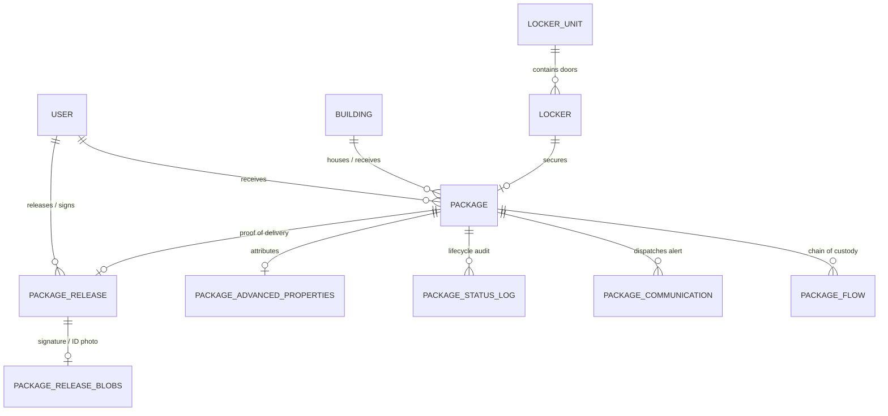

# Smiota Parcel & Smart Locker Database Query Catalog

This document provides a comprehensive, intent-mapped catalog of natural language queries and questions that can be queried directly from the Smiota database schema (`consolidated_schema.sql`). 

Each entry details the **User Question Variations**, the **Underlying Intent**, the **Database Tables & Fields**, and the **SQL Query Logic**.

---

## Table of Contents
1. [Core Benchmark Inquiries](#1-core-benchmark-inquiries)
2. [Real-Time Tracking, Ingestion & Lifecycle Status](#2-real-time-tracking-ingestion--lifecycle-status)
3. [Physical Storage, Locker Allocation & Mailroom Shelf Location](#3-physical-storage-locker-allocation--mailroom-shelf-location)
4. [Campus Chain of Custody & Multi-Building Transit](#4-campus-chain-of-custody--multi-building-transit)
5. [Pickup Credentials, Passcodes & Kiosk Sessions](#5-pickup-credentials-passcodes--kiosk-sessions)
6. [Expiration Deadlines, Vacation Holds & Scheduled Reminders](#6-expiration-deadlines-vacation-holds--scheduled-reminders)
7. [Physical Dimensions, OCR & Special Handling (Perishables/Oversized)](#7-physical-dimensions-ocr--special-handling-perishablesoversized)
8. [Sender, Carrier & Vendor Intelligence](#8-sender-carrier--vendor-intelligence)
9. [ADA Wheelchair Accessibility & Delegated / Proxy Pickup](#9-ada-wheelchair-accessibility--delegated--proxy-pickup)
10. [Proof of Pickup (POD), Signatures & Identity Verification](#10-proof-of-pickup-pod-signatures--identity-verification)
11. [Communication Logs, Alerts & Notification Delivery Status](#11-communication-logs-alerts--notification-delivery-status)
12. [Outbound Drop-Offs, Returns & Courier Sweeps](#12-outbound-drop-offs-returns--courier-sweeps)
13. [Day-Use / Personal Temporary Storage Pods](#13-day-use--personal-temporary-storage-pods)
14. [Exceptions, Damage Reports & Triage Reason Codes](#14-exceptions-damage-reports--triage-reason-codes)
15. [User Aggregate Summaries & Historical Pickup Logs](#15-user-aggregate-summaries--historical-pickup-logs)
16. [Locker Hardware Telemetry, Door Sensors & Maintenance Diagnostics](#16-locker-hardware-telemetry-door-sensors--maintenance-diagnostics)

---

## 1. Core Benchmark Inquiries

### Q1: Tracking Number Lookup
- **User Questions:**
  - *"Where is my package? The tracking number is 1Z9999999999999999?"*
  - *"Can you look up package 1Z9999999999999999?"*
  - *"What is the status of tracking code 1Z9999999999999999?"*
- **Intent:** Locate parcel record by exact tracking number, return current lifecycle status, building, and storage point.
- **Tables & Fields:** `package.tracking_number`, `package.STATUS`, `package_status.NAME`, `package.currently_at_building_id`, `building.NAME`, `package.LOCKER_ID`, `locker.NAME`
- **SQL Logic:**
  ```sql
  SELECT p.tracking_number, ps.NAME AS status_name, b.NAME AS current_building, 
         l.NAME AS locker_name, p.status_change_time
  FROM package p
  JOIN package_status ps ON p.STATUS = ps.id
  LEFT JOIN building b ON p.currently_at_building_id = b.ID
  LEFT JOIN locker l ON p.LOCKER_ID = l.ID
  WHERE p.tracking_number = '1Z9999999999999999' AND p.is_deleted = 0;
  ```

---

### Q2: Carrier Arrival on Date
- **User Questions:**
  - *"Did my Amazon order arrive at the mailroom today?"*
  - *"Has FedEx dropped off any packages for me this morning?"*
  - *"Did my UPS parcel come in yet?"*
- **Intent:** Check if a package from a specified courier was scanned in for the current user on today's date.
- **Tables & Fields:** `package.RECIPIENT_ID`, `package.COURIER`, `package.RECEIVED_TIME`
- **SQL Logic:**
  ```sql
  SELECT p.id, p.tracking_number, p.COURIER, p.RECEIVED_TIME, ps.NAME AS status
  FROM package p
  JOIN package_status ps ON p.STATUS = ps.id
  WHERE p.RECIPIENT_ID = :user_id
    AND LOWER(p.COURIER) LIKE '%amazon%'
    AND DATE(p.RECEIVED_TIME) = CURDATE()
    AND p.is_deleted = 0;
  ```

---

### Q3: Active Packages Awaiting Pickup
- **User Questions:**
  - *"How many packages do I currently have waiting for me to pick up?"*
  - *"Do I have anything to collect right now?"*
  - *"Show me all my uncollected parcels."*
- **Intent:** Count and list all uncollected parcels associated with the user account.
- **Tables & Fields:** `package.RECIPIENT_ID`, `package.STATUS`, `package_status.NAME`
- **SQL Logic:**
  ```sql
  SELECT COUNT(*) AS pending_count,
         GROUP_CONCAT(p.tracking_number SEPARATOR ', ') AS tracking_numbers
  FROM package p
  JOIN package_status ps ON p.STATUS = ps.id
  WHERE p.RECIPIENT_ID = :user_id
    AND ps.NAME NOT IN ('RELEASED', 'RETURNED_TO_SENDER', 'CANCELLED', 'PURGED')
    AND p.is_deleted = 0;
  ```

---

### Q4: 30-Day Historical Pickup Log
- **User Questions:**
  - *"Show me a list of all packages I picked up over the last 30 days?"*
  - *"What packages did I collect this past month?"*
  - *"My past 30 days pickup history."*
- **Intent:** Query historical packages released to the user within the last 30 days.
- **Tables & Fields:** `package_release.RELEASE_TO_USER_ID`, `package_release.TIME_RELEASED`, `package.tracking_number`, `package.COURIER`
- **SQL Logic:**
  ```sql
  SELECT pr.TIME_RELEASED, p.tracking_number, p.COURIER, pr.RELEASE_TO_NAME
  FROM package_release pr
  JOIN package p ON pr.PACKAGE_ID = p.ID
  WHERE pr.RELEASE_TO_USER_ID = :user_id
    AND pr.TIME_RELEASED >= DATE_SUB(NOW(), INTERVAL 30 DAY)
  ORDER BY pr.TIME_RELEASED DESC;
  ```

---

### Q5: Desk Shelf vs. Smart Locker Storage
- **User Questions:**
  - *"Are my packages sitting on the mailroom front desk shelf or locked inside a PoD locker?"*
  - *"Is my box in a locker or do I have to wait in line at the mail counter?"*
  - *"Which of my packages are in lockers and which are on the overflow shelf?"*
- **Intent:** Differentiate packages secured in automated lockers from those staged on manual shelves or counters.
- **Tables & Fields:** `package.LOCKER_ID`, `locker.NAME`, `package.STATUS`
- **SQL Logic:**
  ```sql
  SELECT p.tracking_number,
         CASE WHEN p.LOCKER_ID IS NOT NULL THEN 'In PoD Locker' ELSE 'Mailroom Desk/Shelf' END AS storage_type,
         l.NAME AS locker_door,
         b.NAME AS building_name
  FROM package p
  LEFT JOIN locker l ON p.LOCKER_ID = l.ID
  LEFT JOIN building b ON p.currently_at_building_id = b.ID
  WHERE p.RECIPIENT_ID = :user_id
    AND p.STATUS IN (SELECT id FROM package_status WHERE NAME NOT IN ('RELEASED', 'PURGED'))
    AND p.is_deleted = 0;
  ```

---

### Q6: Carrier Dock Arrival vs. Smiota Intake Reconciliation
- **User Questions:**
  - *"My carrier says 'Delivered to Dock' at 9:00 AM, but Smiota says 'In Transit'. Where is it?"*
  - *"FedEx marked it delivered hours ago, why hasn't Smiota notified me?"*
  - *"Why is my package still showing In Transit if carrier dropped it off?"*
- **Intent:** Reconcile external carrier dock handoff with internal central mailroom intake and transit scanning.
- **Tables & Fields:** `package.tracking_number`, `package.RECEIVED_TIME`, `package.status_change_time`, `package_flow.received_at_building_time`, `package_status.NAME`
- **SQL Logic:**
  ```sql
  SELECT p.tracking_number, ps.NAME AS current_smiota_status,
         p.RECEIVED_TIME AS dock_intake_time,
         pf.received_at_building_time AS current_building_scan_time,
         b.NAME AS current_building
  FROM package p
  JOIN package_status ps ON p.STATUS = ps.id
  LEFT JOIN package_flow pf ON p.ID = pf.package_id
  LEFT JOIN building b ON p.currently_at_building_id = b.ID
  WHERE p.tracking_number = :tracking_number;
  ```

---

### Q7: Step-by-Step Chain of Custody History
- **User Questions:**
  - *"Show me the step-by-step history of who moved my package since it arrived on campus?"*
  - *"Who handled my parcel and when was it transferred?"*
  - *"Can I see the audit trail of everyone who scanned my box?"*
- **Intent:** Provide a detailed chronological log of every building transition, handler user ID, and locker deposit event.
- **Tables & Fields:** `package_status_log`, `package_flow`, `user.FIRST_NAME`, `user.LAST_NAME`, `building.NAME`
- **SQL Logic:**
  ```sql
  SELECT psl.STATUS_CHANGE_TIME, ps.NAME AS status_reached,
         CONCAT(u.FIRST_NAME, ' ', u.LAST_NAME) AS handled_by_staff,
         cb.NAME AS from_or_current_building, db.NAME AS destination_building
  FROM package_status_log psl
  JOIN package_status ps ON psl.PACKAGE_STATUS_ID = ps.id
  JOIN user u ON psl.UPDATED_BY_USER_ID = u.ID
  LEFT JOIN building cb ON psl.CURRENT_BUILDING = cb.ID
  LEFT JOIN building db ON psl.DESTINATION_BUILDING = db.ID
  WHERE psl.PACKAGE_ID = (SELECT ID FROM package WHERE tracking_number = :tracking_number LIMIT 1)
  ORDER BY psl.STATUS_CHANGE_TIME ASC;
  ```

---

### Q8: Sender Information & Package Type
- **User Questions:**
  - *"Can I see the sender information and package type for my incoming parcel?"*
  - *"Who sent this package and what type of box is it?"*
  - *"Is this a parcel, an envelope, or a crate, and who is the vendor?"*
- **Intent:** Retrieve sender/vendor name and package classification category.
- **Tables & Fields:** `package.SENDER_INFO`, `sender.NAME`, `package_type.NAME`, `customer_package_type.NAME`
- **SQL Logic:**
  ```sql
  SELECT p.tracking_number, 
         COALESCE(s.NAME, p.SENDER_INFO) AS sender_name,
         pt.NAME AS standard_package_type,
         cpt.name AS customer_custom_package_type
  FROM package p
  LEFT JOIN sender s ON p.SENDER_ID = s.ID
  LEFT JOIN package_type pt ON p.TYPE = pt.ID
  LEFT JOIN customer_package_type cpt ON p.TYPE = cpt.id
  WHERE p.tracking_number = :tracking_number;
  ```

---

## 2. Real-Time Tracking, Ingestion & Lifecycle Status

| # | User Question Variations | Business Intent | Underlying DB Columns & Tables |
|---|---|---|---|
| 2.1 | *"What time was my package officially checked in?"* / *"When did Smiota first scan my tracking number?"* | Intake timestamp lookup | `package.RECEIVED_TIME`, `package.tracking_number` |
| 2.2 | *"Who signed for or scanned my package at the central loading dock?"* | Dock receiving personnel | `package.RECEIVED_BY_ID` → `user.FIRST_NAME`, `user.LAST_NAME` |
| 2.3 | *"Has my package cleared central sorting and left for my residential building?"* | Intra-campus transit flag | `package.STATUS`, `package_status.NAME`, `package.is_at_destination` |
| 2.4 | *"Can I search for my package using an internal PO number `PO-99120`?"* | Purchase order reference | `package_advanced_properties.po_number`, `package_advanced_properties.package_id` |
| 2.5 | *"Find package by external system reference ID `EXT-5521`"* | Third-party ERP/WMS cross-reference | `package.EXTERNAL_ID`, `package_external_data.package_external_id` |
| 2.6 | *"What color tag or label status was assigned to my delivery?"* | Color-coded status badge | `package_status.color`, `package_status_assignment.color` |

---

## 3. Physical Storage, Locker Allocation & Mailroom Shelf Location

| # | User Question Variations | Business Intent | Underlying DB Columns & Tables |
|---|---|---|---|
| 3.1 | *"Which specific locker bank is holding my items?"* / *"Is it in Locker Bank A or Locker Bank B?"* | Locker unit/controller bank ID | `package.LOCKER_ID` → `locker.UNIT_CONTROLLER_ID` → `locker_unit.NAME`, `locker_unit.description` |
| 3.2 | *"What door or box number do I walk up to?"* | Locker door identifier | `package.LOCKER_ID` → `locker.NAME` |
| 3.3 | *"What size locker compartment was allocated for my delivery?"* | Compartment sizing verification | `locker.SIZE` → `locker_size.NAME` (Small, Medium, Large, Custom) |
| 3.4 | *"Is my package held at the main campus mail center or the local dorm satellite locker?"* | Satellite vs central location | `location.NAME`, `building.NAME`, `satellite_locker_unit` |
| 3.5 | *"If my package is on a shelf, which shelf section or bin is it in?"* | Overflow shelf location notes | `package.NOTES`, `package_advanced_properties.pickup_delivery_external_id` |

---

## 4. Campus Chain of Custody & Multi-Building Transit

| # | User Question Variations | Business Intent | Underlying DB Columns & Tables |
|---|---|---|---|
| 4.1 | *"Which delivery van or driver delivered my box to my building?"* | Inter-building courier transit user | `package_flow.delivered_to_building_by_id` → `user.FIRST_NAME`, `user.LAST_NAME` |
| 4.2 | *"What time did the package arrive at my building's mail stop?"* | Building intake timestamp | `package_flow.received_at_building_time` |
| 4.3 | *"Was my package part of a consolidated hamper, tote, or cart delivery?"* | Batch / Package Grouping tracking | `package_group_package.package_group_id`, `package_group.name` |
| 4.4 | *"What is the current status of the package tote / group containing my box?"* | Package group lifecycle status | `package_group_status.name`, `package_group_status_log.status_change_time` |
| 4.5 | *"Was my package mistakenly routed to the wrong building?"* | Route mismatch detection | `package.intended_for_building_id` vs. `package.currently_at_building_id` |

---

## 5. Pickup Credentials, Passcodes & Kiosk Sessions

| # | User Question Variations | Business Intent | Underlying DB Columns & Tables |
|---|---|---|---|
| 5.1 | *"What is my 6-digit PIN / pickup passcode for today's delivery?"* | OTP / Passcode retrieval | `package.PASSCODE`, `user.PASSCODE` |
| 5.2 | *"Can you reset or generate a new locker release passcode for me?"* | Passcode regeneration | `package.PASSCODE`, `user.last_passcode_created_time` |
| 5.3 | *"Can I tap my student ID / staff RFID badge at the kiosk to open the locker?"* | RFID badge enrollment check | `user.badge_id`, `security_card.CARD_NUMBER`, `security_card.INACTIVE` |
| 5.4 | *"Did my kiosk pickup session time out before I took my package?"* | Kiosk session duration check | `transaction_session.start_time`, `transaction_session.end_time`, `transaction_session.is_timeout` |
| 5.5 | *"Did the kiosk register that the locker door opened and closed?"* | Deposit/Retrieval door transaction | `transaction.is_deposit`, `transaction.start_time`, `transaction.end_time` |
| 5.6 | *"Why does the kiosk screen say 'Invalid Code'?"* | Code expiration or mismatch check | `package.PASSCODE`, `package.STATUS`, `package.EXPIRATION_TIME` |

---

## 6. Expiration Deadlines, Vacation Holds & Scheduled Reminders

| # | User Question Variations | Business Intent | Underlying DB Columns & Tables |
|---|---|---|---|
| 6.1 | *"When is the final deadline to pick up my package before it is removed?"* | Expiration timestamp lookup | `package.EXPIRATION_TIME` |
| 6.2 | *"Can I put my package on hold because I am away on vacation?"* | Vacation hold verification | `reserve.hold_start_time`, `reserve.hold_end_time`, `reserve_package.package_id` |
| 6.3 | *"How many pickup reminder emails or SMS texts have been sent to me?"* | Reminder notification count | `scheduled_reminders_results.num_of_users`, `package_communication.TIME_SENT` |
| 6.4 | *"Has my package been flagged as abandoned or marked for return to sender?"* | Abandonment / Return state | `package.STATUS` → `package_status.NAME` (e.g., *EXPIRED*, *RTS*) |
| 6.5 | *"How many days does our campus policy allow packages to sit in lockers?"* | Location retention configuration | `location_properties.package_expiration_days`, `config_values.value` |

---

## 7. Physical Dimensions, OCR & Special Handling (Perishables/Oversized)

| # | User Question Variations | Business Intent | Underlying DB Columns & Tables |
|---|---|---|---|
| 7.1 | *"Is this package marked as perishable, refrigerated, or cold storage?"* | Perishable parcel flag | `package_advanced_properties.is_perishable` |
| 7.2 | *"Why wasn't my parcel deposited into a locker?"* | Oversized overflow check | `package.didnt_fit` (1 = True) |
| 7.3 | *"What are the measured dimensions (L x W x H) of my box?"* | Dimension measurements | `package.dimension_1`, `package.dimension_2`, `package.dimension_3` |
| 7.4 | *"Is my delivery classified as Priority or Urgent Mail?"* | Priority mail classification | `package.IS_PRIORITY_MAIL`, `package_priority_types.name` |
| 7.5 | *"How many sub-items or boxes belong to this single master tracking number?"* | Multi-piece shipment count | `package_advanced_properties.number_of_subitems` |
| 7.6 | *"Can I see the scanned label photo or optical character recognition text?"* | Label OCR and image retrieval | `package.LABEL_PHOTO`, `package.has_label_pic`, `package.LABEL_OCR`, `package.OCR_TEXT` |

---

## 8. Sender, Carrier & Vendor Intelligence

| # | User Question Variations | Business Intent | Underlying DB Columns & Tables |
|---|---|---|---|
| 8.1 | *"Who shipped this package to me?"* / *"What is the sender's name and address?"* | Shipper / Sender details | `package.SENDER_INFO`, `sender.NAME`, `sender.COMPANY`, `sender.ADDRESS_LINE1` |
| 8.2 | *"Which courier driver deposited this package into the locker?"* | Courier user credentials | `package.COURIER_ID` → `courier_user.FIRST_NAME`, `courier.NAME` |
| 8.3 | *"Can I see a list of all carriers delivering to our campus today?"* | Active couriers on campus | `courier.NAME`, `courier.INACTIVE`, `package.COURIER` |
| 8.4 | *"Does this package have a third-party tracking barcode or delivery external ID?"* | External delivery ID mapping | `package_advanced_properties.pickup_delivery_external_id` |

---

## 9. ADA Wheelchair Accessibility & Delegated / Proxy Pickup

| # | User Question Variations | Business Intent | Underlying DB Columns & Tables |
|---|---|---|---|
| 9.1 | *"Is my account configured to only assign bottom-tier ADA accessible lockers?"* | ADA accessibility compliance | `user.needs_wheel_chair_access` (1 = True) |
| 9.2 | *"Can I designate my roommate or assistant to pick up my parcels?"* | Pickup delegation setup | `user.delegate_notifications_to_user_id` → `user.FIRST_NAME`, `user.LAST_NAME` |
| 9.3 | *"Who is authorized as an alternate recipient on my account?"* | Alternate recipient mapping | `alternate_recipient.recipient_id`, `alternate_recipient.tag_id` |
| 9.4 | *"Can my packages be delivered to an alternate building or unit address?"* | Alternate building reroute | `alternate_address.building_id`, `alternate_address.unit_no` |
| 9.5 | *"Who actually picked up my package if it wasn't me?"* | Proxy release audit | `package_release.RELEASE_TO_NAME`, `package_release.RELEASE_TO_EXTERNAL`, `package_release.RELEASE_TO_USER_ID` |

---

## 10. Proof of Pickup (POD), Signatures & Identity Verification

| # | User Question Variations | Business Intent | Underlying DB Columns & Tables |
|---|---|---|---|
| 10.1 | *"At what exact time and date was my package picked up?"* | Timestamp of final release | `package_release.TIME_RELEASED` |
| 10.2 | *"Which mailroom staff member handed my package over at the counter?"* | Staff release clerk | `package_release.RELEASED_BY_USER_ID` → `user.FIRST_NAME`, `user.LAST_NAME` |
| 10.3 | *"Is there a digital signature on file for this pickup?"* | Stored signature blob | `package_release_blobs.SIGNATURE` (mediumblob), `package_release_blobs.CREATED_TIME` |
| 10.4 | *"What photo ID or government identification was checked during pickup?"* | ID inspection records | `package_release.ID_TYPE`, `package_release.ID_NUMBER`, `package_release_blobs.ID_PHOTO` |
| 10.5 | *"Are there any notes or remarks made by the clerk upon release?"* | Release clerk annotations | `package_release.NOTES` |

---

## 11. Communication Logs, Alerts & Notification Delivery Status

| # | User Question Variations | Business Intent | Underlying DB Columns & Tables |
|---|---|---|---|
| 11.1 | *"Was a pickup SMS or email sent to me when the package arrived?"* | Dispatch log inspection | `package_communication.COMMUNICATION_TYPE` (1=Email, 2=SMS, 3=App, 4=Voice), `package_communication.TIME_SENT` |
| 11.2 | *"Why did my text message fail to deliver?"* | Failed notification diagnostics | `pending_package_communication.TRIED_BUT_FAILED`, `pending_package_communication.ERROR_MSG` |
| 11.3 | *"What is the delivery status of my mobile push notification?"* | Mobile app push message log | `package_communication_app.STATUS`, `package_communication_app.BODY`, `package_communication_app.TIME_SENT` |
| 11.4 | *"What email address was used to send my delivery notification?"* | Recipient email record | `package_communication_email.TO_EMAIL`, `package_communication_email.STATUS_MESSAGE` |
| 11.5 | *"What are my active communication channel preferences?"* | Recipient notification priority | `user.preferred_communication_method1`, `preferred_communication_method2`, `preferred_communication_method3` |
| 11.6 | *"Did I accidentally unsubscribe or opt out of SMS alerts?"* | Twilio opt-in/opt-out status | `user.OPT_OUT_OPTION`, `user.PHONE_UNSUBSCRIBE`, `twilio_incoming_message.action_type` |

---

## 12. Outbound Drop-Offs, Returns & Courier Sweeps

| # | User Question Variations | Business Intent | Underlying DB Columns & Tables |
|---|---|---|---|
| 12.1 | *"Can I drop off a prepaid outbound return package in a locker?"* | Outbound package registration | `package.IS_OUTBOUND` (1 = True) |
| 12.2 | *"Has the courier picked up my return parcel from the locker yet?"* | Courier return sweep verification | `package.STATUS` → `package_status.NAME`, `package.status_change_time` |
| 12.3 | *"Which carrier is designated to collect my outgoing box?"* | Carrier assignment for returns | `package.COURIER_ID` → `courier.NAME` |
| 12.4 | *"What label template or return shipping label was generated?"* | Outbound label configs | `package_label_templates.template`, `package_label_templates.is_outbound` |

---

## 13. Day-Use / Personal Temporary Storage Pods

| # | User Question Variations | Business Intent | Underlying DB Columns & Tables |
|---|---|---|---|
| 13.1 | *"Do I currently have an active Day-Use personal locker checked out?"* | Personal locker allocation | `day_use_pod.name`, `day_use_pod.customer_id`, `day_use_pod.location_id` |
| 13.2 | *"When does my temporary personal locker reservation expire?"* | Reservation schedule | `reserve.start_time`, `reserve.end_time`, `reserve.hold_end_time` |
| 13.3 | *"What is the status of my locker reservation (e.g., Active, Expired, Released)?"* | Reservation state | `reserve.reserve_status_id` → `reserve_status.name` |
| 13.4 | *"Which day-use lockers are currently available for booking in Building 3?"* | Vacant day-use lockers | `day_use_pod.inactive`, `day_use_pod.building_id`, `locker.STATUS_CODE` |

---

## 14. Exceptions, Damage Reports & Triage Reason Codes

| # | User Question Variations | Business Intent | Underlying DB Columns & Tables |
|---|---|---|---|
| 14.1 | *"Why is my package marked with a Problem or Exception status?"* | Exception reason lookup | `package_advanced_properties.package_problem_reason` → `package_problem_reason.name` |
| 14.2 | *"Did staff record that my parcel was damaged, crushed, or opened when received?"* | Condition triage notes | `package.NOTES`, `package_problem_reason.description` |
| 14.3 | *"Was my package flagged for missing or unreadable recipient information?"* | OCR mismatch / Unresolved recipient | `package.NOTES`, `package.LABEL_OCR`, `package.RECIPIENT_ID IS NULL` |
| 14.4 | *"What changes were made to my package details by the mailroom staff?"* | Modification change log | `package_edit_log.updated_by_user_name`, `package_edit_log.updated_time`, `package_edit_log.package_data` |

---

## 15. User Aggregate Summaries & Historical Pickup Logs

| # | User Question Variations | Business Intent | Underlying DB Columns & Tables |
|---|---|---|---|
| 15.1 | *"How many total packages are waiting for me across all campus locations?"* | Total active parcel count | `COUNT(package.ID)` WHERE `RECIPIENT_ID = :user_id` AND `STATUS NOT IN ('RELEASED')` |
| 15.2 | *"Can I see a complete summary of all packages delivered to me this semester / year?"* | Longitudinal volume reporting | `COUNT(package.ID)` GROUP BY `MONTH(RECEIVED_TIME)` |
| 15.3 | *"What percentage of my packages were delivered to lockers versus picked up at the desk?"* | Channel utilization metric | `package.LOCKER_ID IS NOT NULL` vs. `package.LOCKER_ID IS NULL` |
| 15.4 | *"What is my average pickup turnaround time after receiving a notification?"* | Turnaround / Dwell time analytics | `TIMESTAMPDIFF(HOUR, package_communication.TIME_SENT, package_release.TIME_RELEASED)` |

---

## 16. Locker Hardware Telemetry, Door Sensors & Maintenance Diagnostics

| # | User Question Variations | Business Intent | Underlying DB Columns & Tables |
|---|---|---|---|
| 16.1 | *"Is locker door #15 currently open or closed?"* | Real-time door sensor status | `locker.IS_GATE_OPEN` (0 = Closed, 1 = Open) |
| 16.2 | *"Is this locker compartment currently reported in an error or fault state?"* | Compartment error status | `locker.IS_IN_ERROR_STATE`, `locker.ERROR_MESSAGE`, `locker.STATUS_CODE` |
| 16.3 | *"Does the locker presence sensor detect an object inside compartment #8?"* | Internal optical sensor state | `locker.do_not_detect_presence`, `locker.STATUS_CODE` |
| 16.4 | *"When is the next scheduled routine maintenance for Locker Bank C?"* | Preventative maintenance schedule | `maint_schedule.start_time`, `maint_schedule.end_time`, `maint_location.location_id` |
| 16.5 | *"Which maintenance tasks and service orders were performed on this locker?"* | Hardware service history | `maint_task.name`, `maint_service_task.status_id`, `maint_service.description` |

---

## Summary Mapping Diagram


